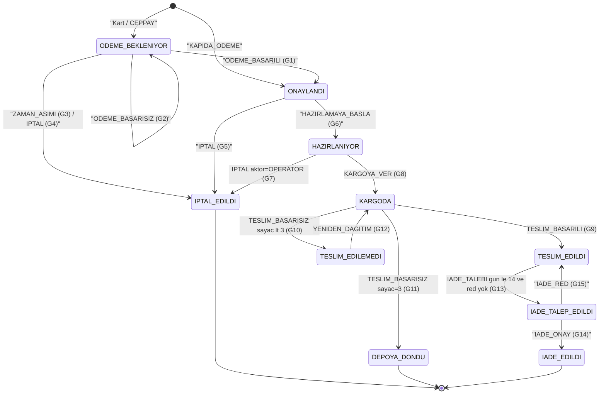

# SFM v1.4 — Test Tasarım Dokümanı

| Alan | Değer |
|---|---|
| Hedef Sistem | Sipariş Fiyatlandırma Motoru (SFM), Sipariş Durum Yönetimi ve E2E Ödeme Akışı |
| Referans Spesifikasyon | `girdiler/SFM-spesifikasyon-v1.4.md` (Doküman No: DK-SPEC-214, Onay Tarihi: 22.09.2026) |
| Hazırlayan | Kıdemli Test Analisti |
| Dil / Çıktı Dizini | Türkçe / `cikti/` |

---

## 1. Yönetici Özeti ve Teslimat Envanteri

Bu doküman, henüz kodu geliştirilmemiş olan SFM v1.4 için geliştirme ile paralel koşulabilecek, deterministik ve kuruş hassasiyetinde doğrulanmış test tasarımını tanımlar.

| Teslimat Dosyası | Kapsam | Vaka / Satır Sayısı | Öne Çıkan Kapsam Özeti |
|---|---|---|---|
| `cikti/test-tasarimi.md` | Test stratejisi, teknikler, modeller ve spesifikasyon bulguları | — | EP, BVA, Karar Tabloları, 10×12 Durum Matrisi, 2-wise analiz, 11 spesifikasyon bulgusu |
| `cikti/fiyat-test-verisi.csv` | SFM fiyatlandırma API (`POST /api/v2/sepet/fiyatla`) vakaları | **73** (`FYT-001`–`FYT-073`) | 40 `KABUL`, 33 hata vakası; tüm 7 hata kodu, yuvarlama, tavan, eşik ve öncelik çiftleri |
| `cikti/durum-gecis-testleri.csv` | Sipariş durum yaşam döngüsü vakaları | **61** (`DGT-001`–`DGT-061`) | 4 başlangıç durumu, G1–G15'in %100'ü, 10 durumun tümünde geçersiz geçişler, 10.5 kural sırası |
| `cikti/konfigurasyon-matrisi.csv` | Manuel E2E ödeme regresyonu matrisi | **13** (`KONF-01`–`KONF-13`) | 75 geçerli konfigürasyondan **59/59 (%100)** geçerli ikili (pairwise) çift + 50/112 üçlü kapsam |

**Kritik Erken Uyarı (Hatalı Örnek Hesaplama):** Spesifikasyonun `Ek-A Örnek 4` satırı (`KLASIK`, `AT=900,00`, `STANDART`, `UZAK`), Madde 6.2 ve 6.5 kurallarıyla doğrudan çelişmektedir (`KU=0,00` yerine `25,00` olmalıdır). Bölüm 6.1'de ayrıntılı açıklanmış, test verisinde Madde 4–8 kuralları esas alınmıştır (`FYT-026`).

---

## 2. Kullanılan Test Tasarım Teknikleri ve Gerekçeleri

| Alan | Kullanılan Teknikler | Gerekçe |
|---|---|---|
| **Fiyatlandırma Motoru (`fiyat-test-verisi.csv`)** | **Denklik Sınıfları (EP)**, **Sınır Değer Analizi (BVA — 2 ve 3 noktalı)**, **Karar Tabloları**, **Hata Tahmini (Error Guessing)** | SFM tamamen iş kuralları, eşik değerler (`150`, `400`, `750`, `1500`, `5000`, `20000`), finansal yuvarlama (`yarım yukarı` vs. `aşağı`) ve hata önceliğine dayalıdır. EP ile geçersiz girdi patlaması önlenir; BVA ile `< / ≤` ve IEEE-754 kayan nokta hataları yakalanır; karar tabloları üyelik × teslimat × bölge × ödeme etkileşimlerini eksiksiz modeller. |
| **Durum Yaşam Döngüsü (`durum-gecis-testleri.csv`)** | **Durum Geçiş Testi (State Transition Testing)**, **Geçiş Matrisi (State×Event)**, **Döngü ve Sayaç Sınır Analizi** | Sipariş yaşam döngüsü durum bağımlıdır; ödeme yeniden denemesi (`G2`), 3 başarısız teslimat sayacı (`G10`/`G11`), 14 günlük iade penceresi ve önceki iade reddi bayrağı (`G13`/`G15`) sıralı olay geçmişine dayanır. Hem tüm geçerli geçişlerin (`G1`–`G15`) hem de ara/son durumlardaki yasak geçişlerin ve Madde 10.5 kural sırasının doğrulanması gerekir. |
| **E2E Konfigürasyonlar (`konfigurasyon-matrisi.csv`)** | **Kısıtlı İkili Kombinasyonel Test (Constrained Pairwise / 2-wise)** + **Risk Tabanlı Duman (Smoke) Eki** | Her manuel E2E koşumu ~15 dk sürdüğünden 108 olası (veya 75 geçerli) kombinasyonun tamamı (18,75–27 saat) sürdürülemezdir. İkili kombinasyonel yöntem tüm faktör çiftlerindeki uyumsuzlukları kuramsal minimum **12 satırda** (%100) yakalar; üzerine en yoğun üretim akışı 1 duman testi olarak eklenerek toplam süre **195 dakikaya (3 saat 15 dk)** indirilmiştir. |

---

## 3. SFM Fiyatlandırma Motoru: Denklik Sınıfları, Sınır Değerleri ve Karar Tabloları

### 3.1 Denklik Sınıfları (Equivalence Partitions)

| Girdi Alanı | Geçerli Denklik Sınıfları | Geçersiz Denklik Sınıfları |
|---|---|---|
| `uyelik` | `MISAFIR`, `KLASIK`, `ALTIN` | Tanımsız değer (`PLATIN`), boş (`""`) → `ERR_GECERSIZ_GIRDI` |
| `ara_toplam` | `(0.01..149.99]` (min altı), `[150.00..399.99]`, `[400.00..749.99]`, `[750.00..1500.00]`, `(1500.00..20000.00]` (biçim: en fazla 2 ondalık basamaklı, `.` ayırıcılı, `250` ve `250.5` dahil) | `≤ 0` (`0.00`, `-50.00`), > 2 ondalık (`250.123`), virgül (`250,00`), binlik ayırıcı (`1.500.00`), boş/sayı dışı → `ERR_GECERSIZ_GIRDI`; `[0.01..149.99]` → `ERR_MIN_SEPET`; `> 20000.00` → `ERR_MAX_SEPET` |
| `kupon` | `""` (boş), `DEFNE10`, ` DEFNE10 ` (baş/son boşluklu), `KITAP50` (koşul sağlayan / sağlamayan durumlar) | Tanımsız kod (`YILBASI20`), büyük/küçük harf uyuşmazlığı (`defne10`) → `ERR_KUPON_GECERSIZ` |
| `teslimat_tipi` | `STANDART`, `HIZLI`, `MAGAZA` | Tanımsız değer (`EKSPRES`), boş → `ERR_GECERSIZ_GIRDI` |
| `bolge` | `STANDART`/`HIZLI` için: `NORMAL`, `UZAK`; `MAGAZA` için: boş/`NORMAL`/`UZAK` (dikkate alınmaz) | `STANDART`/`HIZLI` iken boş veya tanımsız (`ADA`) → `ERR_GECERSIZ_GIRDI`; `HIZLI` + `UZAK` → `ERR_TESLIMAT_BOLGE` |
| `odeme_yontemi` | `KREDI_KARTI`, `BANKA_KARTI`, `CEPPAY` (fiyatlamada özdeş, SFM üyelik/platform kontrolü yapmaz), `KAPIDA_ODEME` | Tanımsız değer (`HAVALE`), boş → `ERR_GECERSIZ_GIRDI`; `KAPIDA_ODEME` + (`HIZLI`\|`MAGAZA`) → `ERR_KAPIDA_UYGUNLUK`; `KAPIDA_ODEME` + `OT > 5000.00` → `ERR_KAPIDA_LIMIT` |

### 3.2 Sınır Değer Analizi (BVA)

| Kural / Madde | Test Edilen Sınır | Seçilen Değerler ve Beklenen Etki | İlgili Test ID |
|---|---|---|---|
| **Min. Sepet (4.1, 4.3)** | `AT = 150.00` | `0.01`, `149.99` → `ERR_MIN_SEPET`; `150.00` → `KABUL`; `150.00 + DEFNE10` (`NT=135.00`) → `KABUL` | `FYT-001`..`004` |
| **Maks. Sepet (4.2, 4.3)** | `AT = 20000.00` | `20000.00` → `KABUL`; `20000.01` → `ERR_MAX_SEPET`; `20020.00 + KITAP50` (`NT=19970.00`) → `ERR_MAX_SEPET` | `FYT-005`..`007` |
| **`DEFNE10` Yuvarlama ve Tavan (2.2, 5.3)** | `AT × 0.10` ve `150.00` | `200.04` (`20.004→20.00`), `200.05` (`20.005→20.01`, bankacı yuvarlama ayrımı), `150.05` (`15.005→15.01`, IEEE-754 float tuzağı), `1499.94` (`149.99`), `1499.95` (`150.00`), `1500.05` (`150.01→150.00` tavan) | `FYT-009`..`014` |
| **`KITAP50` Eşiği (5.4, 5.5)** | `AT = 400.00` | `399.99` → `KABUL`, `KI=0.00`; `400.00` (`KLASIK`/`ALTIN`) → `KI=50.00`; `500.00` (`MISAFIR`) → `KI=0.00` | `FYT-016`..`019` |
| **Ücretsiz Kargo / Hızlı İndirim Eşiği (6.2, 6.4b)** | `NT = 750.00` | `NT=749.99` (`AT=749.99` veya `799.99+KITAP50` veya `833.32+DEFNE10`) → indirim yok; `NT=750.00` (`750.00` veya `833.33+DEFNE10` veya `800.00+KITAP50`) → eşik sağlanır | `FYT-020`..`023`, `030`, `031` |
| **Kapıda Ödeme Limiti (7.3)** | `OT = 5000.00` | `NORMAL`: `4987.10` (`OT=5000.00`) vs `4987.11` (`ERR`); `UZAK KLASIK`: `4962.10` (`OT=5000.00`) vs `4962.11` (`ERR`); `UZAK ALTIN`: `4987.10` (`OT=5000.00`); `5037.10+KITAP50` (`OT=5000.00`); `5137.11+DEFNE10` (`ERR`) | `FYT-036`..`042` |
| **Sadakat Puanı Aşağı Yuvarlama (2.3, 8.2, 8.3)** | `⌊NT / 10⌋` ve `⌊taban × 1,5⌋` | `KLASIK NT=199.99` (`OT=252.79`) → `19` puan (`20` veya `25` değil); `ALTIN NT=219.00` → `⌊21×1.5⌋=31` (önce taban yuvarlanmazsa `32` çıkar) | `FYT-043`..`045` |

### 3.3 İş Kuralları Karar Tabloları

#### Tablo A — Kupon Hesaplama Karar Tablosu (Önkoşul: `150.00 ≤ AT ≤ 20000.00`)

| Koşul / Kural | K1 | K2 | K3 | K4 | K5 | K6 | K7 |
|---|---|---|---|---|---|---|---|
| `kupon` (kırpılmış) | `""` | Tanımsız / küçük harf | `DEFNE10` (`AT ≤ 1500.04`) | `DEFNE10` (`AT ≥ 1500.05`) | `KITAP50` | `KITAP50` | `KITAP50` |
| `uyelik` | Herhangi | Herhangi | Herhangi | Herhangi | `MISAFIR` | `KLASIK`\|`ALTIN` | `KLASIK`\|`ALTIN` |
| `AT ≥ 400.00` | — | — | — | — | — | Hayır | Evet |
| **Sonuç / `KI`** | `0.00` | `ERR_KUPON_GECERSIZ` | `rhu(AT×0.10)` | `150.00` (tavan) | `0.00` | `0.00` | `50.00` |
| **`kupon_uygulandi`** | `false` | (hata) | `true` | `true` | `false` | `false` | `true` |

#### Tablo B — Kargo Ücreti (`KU`) ve Hizmet Bedeli (`HB`) Karar Tablosu

| `teslimat_tipi` | `bolge` | `uyelik` | `NT ≥ 750.00` | `odeme_yontemi` | `KU` (TL) | `HB` (TL) | Hata / Not |
|---|---|---|---|---|---|---|---|
| `STANDART` | `NORMAL` | `MISAFIR` \| `KLASIK` | Hayır | Kart / CEPPAY | `39.90` | `0.00` | — |
| `STANDART` | `NORMAL` | `MISAFIR` \| `KLASIK` | Evet | Kart / CEPPAY | `0.00` | `0.00` | — |
| `STANDART` | `NORMAL` | `ALTIN` | Hayır / Evet | Kart / CEPPAY | `0.00` | `0.00` | 6.3 avantajı |
| `STANDART` | `UZAK` | `MISAFIR` \| `KLASIK` | Hayır | Kart / CEPPAY | `64.90` | `0.00` | `39.90 + 25.00` |
| `STANDART` | `UZAK` | `MISAFIR` \| `KLASIK` | Evet | Kart / CEPPAY | **`25.00`** | `0.00` | **6.5 (`Ek-A Örnek 4` hatalı `0,00` yazar!)** |
| `STANDART` | `UZAK` | `ALTIN` | Hayır / Evet | Kart / CEPPAY | `0.00` | `0.00` | 6.3 uzak ücreti de sıfırlar |
| `STANDART` | `NORMAL` \| `UZAK` | Herhangi | Yukarıdaki gibi | `KAPIDA_ODEME` | Yukarıdaki `KU` | `12.90` | `OT > 5000.00` ise `ERR_KAPIDA_LIMIT` |
| `HIZLI` | `NORMAL` | Herhangi | Hayır | Kart / CEPPAY | `79.90` | `0.00` | 6.4c (`ALTIN` indirim almaz) |
| `HIZLI` | `NORMAL` | Herhangi | Evet | Kart / CEPPAY | `40.00` | `0.00` | `79.90 - 39.90` (6.4b) |
| `HIZLI` | `UZAK` | Herhangi | — | Herhangi | — | — | `ERR_TESLIMAT_BOLGE` (öncelik 5) |
| `HIZLI` | `NORMAL` | Herhangi | — | `KAPIDA_ODEME` | — | — | `ERR_KAPIDA_UYGUNLUK` (öncelik 6) |
| `MAGAZA` | Boş \| `NORMAL` \| `UZAK` | Herhangi | — | Kart / CEPPAY | `0.00` | `0.00` | 6.6 (`bolge` dikkate alınmaz) |
| `MAGAZA` | Boş \| `NORMAL` \| `UZAK` | Herhangi | — | `KAPIDA_ODEME` | — | — | `ERR_KAPIDA_UYGUNLUK` (öncelik 6) |

#### Tablo C — Hata Öncelik Doğrulama Matrisi (Madde 9.3)

Sıralama: `1. ERR_GECERSIZ_GIRDI > 2. ERR_KUPON_GECERSIZ > 3. ERR_MIN_SEPET > 4. ERR_MAX_SEPET > 5. ERR_TESLIMAT_BOLGE > 6. ERR_KAPIDA_UYGUNLUK > 7. ERR_KAPIDA_LIMIT`.
*(Not: `3. ERR_MIN_SEPET` ve `4. ERR_MAX_SEPET` sayısal olarak birbirini dışladığından eşzamanlı oluşamaz.)*

- `1 > 2,3,5,6`: `FYT-064` | `1 > 2`: `FYT-065` | `2 > 3`: `FYT-066` | `2 > 4`: `FYT-067`
- `3 > 5,6`: `FYT-068` | `4 > 5,6,7`: `FYT-069` | `4 > 7`: `FYT-070`
- `5 > 6,7`: `FYT-071` | `6 > 7` (`HIZLI`): `FYT-072` | `6 > 7` (`MAGAZA`): `FYT-073`

---

## 4. Sipariş Durum Yaşam Döngüsü Modeli (`durum-gecis-testleri.csv`)

### 4.1 Durum Geçiş Diyagramı

### 4.2 Tam Durum × Olay Geçiş Matrisi (Geçerli ve Geçersiz Geçişler)

Kısaltmalar: `GEÇERSİZ` = `ERR_GECERSIZ_GECIS`; tanımlı olmayan olay adı (her durumda) = `ERR_GECERSIZ_GIRDI` (10.5.1).

| Kaynak Durum | `ODEME_BASARILI` | `ODEME_BASARISIZ` | `ZAMAN_ASIMI` | `IPTAL(MUSTERI)` | `IPTAL(OPERATOR)` | `HAZIRLAMAYA_BASLA` | `KARGOYA_VER` | `TESLIM_BASARILI` | `TESLIM_BASARISIZ` | `YENIDEN_DAGITIM` | `IADE_TALEBI(gun)` | `IADE_ONAY` | `IADE_RED` |
|---|---|---|---|---|---|---|---|---|---|---|---|---|---|
| **`ODEME_BEKLENIYOR`** | `ONAYLANDI` (G1) | `ODEME_BEKLENIYOR` (G2) | `IPTAL_EDILDI` (G3) | `IPTAL_EDILDI` (G4) | `IPTAL_EDILDI` (G4) | `GEÇERSİZ` | `GEÇERSİZ` | `GEÇERSİZ` | `GEÇERSİZ` | `GEÇERSİZ` | `GEÇERSİZ` | `GEÇERSİZ` | `GEÇERSİZ` |
| **`ONAYLANDI`** | `GEÇERSİZ` | `GEÇERSİZ` | `GEÇERSİZ` | `IPTAL_EDILDI` (G5) | `IPTAL_EDILDI` (G5) | `HAZIRLANIYOR` (G6) | `GEÇERSİZ` | `GEÇERSİZ` | `GEÇERSİZ` | `GEÇERSİZ` | `GEÇERSİZ` | `GEÇERSİZ` | `GEÇERSİZ` |
| **`HAZIRLANIYOR`** | `GEÇERSİZ` | `GEÇERSİZ` | `GEÇERSİZ` | `GEÇERSİZ` (G7 red) | `IPTAL_EDILDI` (G7) | `GEÇERSİZ` | `KARGODA` (G8) | `GEÇERSİZ` | `GEÇERSİZ` | `GEÇERSİZ` | `GEÇERSİZ` | `GEÇERSİZ` | `GEÇERSİZ` |
| **`KARGODA`** | `GEÇERSİZ` | `GEÇERSİZ` | `GEÇERSİZ` | `GEÇERSİZ` (10.6) | `GEÇERSİZ` (10.6) | `GEÇERSİZ` | `GEÇERSİZ` | `TESLIM_EDILDI` (G9) | `sayac<3: TESLIM_EDILEMEDI` (G10) / `sayac=3: DEPOYA_DONDU` (G11) | `GEÇERSİZ` | `GEÇERSİZ` | `GEÇERSİZ` | `GEÇERSİZ` |
| **`TESLIM_EDILEMEDI`** | `GEÇERSİZ` | `GEÇERSİZ` | `GEÇERSİZ` | `GEÇERSİZ` (10.6) | `GEÇERSİZ` (10.6) | `GEÇERSİZ` | `GEÇERSİZ` | `GEÇERSİZ` | `GEÇERSİZ` | `KARGODA` (G12) | `GEÇERSİZ` | `GEÇERSİZ` | `GEÇERSİZ` |
| **`TESLIM_EDILDI`** | `GEÇERSİZ` | `GEÇERSİZ` | `GEÇERSİZ` | `GEÇERSİZ` | `GEÇERSİZ` | `GEÇERSİZ` | `GEÇERSİZ` | `GEÇERSİZ` | `GEÇERSİZ` | `GEÇERSİZ` | `gun≤14 & red yok: IADE_TALEP_EDILDI` (G13); `gun>14: ERR_IADE_SURESI`; `red var: ERR_IADE_TEKRAR` | `GEÇERSİZ` | `GEÇERSİZ` |
| **`IADE_TALEP_EDILDI`** | `GEÇERSİZ` | `GEÇERSİZ` | `GEÇERSİZ` | `GEÇERSİZ` | `GEÇERSİZ` | `GEÇERSİZ` | `GEÇERSİZ` | `GEÇERSİZ` | `GEÇERSİZ` | `GEÇERSİZ` | `GEÇERSİZ` | `IADE_EDILDI` (G14) | `TESLIM_EDILDI` (G15) |
| **`IADE_EDILDI`** *(Son)* | `GEÇERSİZ` | `GEÇERSİZ` | `GEÇERSİZ` | `GEÇERSİZ` | `GEÇERSİZ` | `GEÇERSİZ` | `GEÇERSİZ` | `GEÇERSİZ` | `GEÇERSİZ` | `GEÇERSİZ` | `GEÇERSİZ` | `GEÇERSİZ` | `GEÇERSİZ` |
| **`IPTAL_EDILDI`** *(Son)* | `GEÇERSİZ` | `GEÇERSİZ` | `GEÇERSİZ` | `GEÇERSİZ` | `GEÇERSİZ` | `GEÇERSİZ` | `GEÇERSİZ` | `GEÇERSİZ` | `GEÇERSİZ` | `GEÇERSİZ` | `GEÇERSİZ` | `GEÇERSİZ` | `GEÇERSİZ` |
| **`DEPOYA_DONDU`** *(Son)* | `GEÇERSİZ` | `GEÇERSİZ` | `GEÇERSİZ` | `GEÇERSİZ` | `GEÇERSİZ` | `GEÇERSİZ` | `GEÇERSİZ` | `GEÇERSİZ` | `GEÇERSİZ` | `GEÇERSİZ` | `GEÇERSİZ` | `GEÇERSİZ` | `GEÇERSİZ` |

### 4.3 Durum Geçiş Test Stratejisi ve Kural Öncelikleri

- **Başlangıç Durumu Kapsamı (`DGT-001`–`004`):** Tüm 4 ödeme yöntemi için sipariş yaratımı (boş `olay_dizisi`) doğrulanmıştır.
- **%100 Geçiş ve Döngü Kapsamı (`DGT-005`–`027`):** `G1`–`G15` arası tüm geçişler, `ODEME_BASARISIZ` çoklu deneme döngüsü, başarısız teslimat sayacının `1`, `2` (`TESLIM_EDILEMEDI` + 3. denemede başarı) ve `3` (`DEPOYA_DONDU`) sınırları ile `IADE_TALEBI(gun=0)` ve `(gun=14)` sınırları kapsanmıştır.
- **Koşul Reddi ve Hata Öncelikleri (`DGT-028`–`031`, `DGT-052`–`061`):**
  - `10.5.1 > 10.5.2`: Son durumda dahi tanımsız olay adı `ERR_GECERSIZ_GIRDI` döner (`DGT-053`).
  - `10.5.2 > 10.5.3`: Olay mevcut durumun geçiş tablosunda yoksa parametre hatasından önce `ERR_GECERSIZ_GECIS` döner (`DGT-061`).
  - `10.5.3 > 10.5.4`: Geçersiz parametre (`gun=-1`) tekrar reddinden önce `ERR_GECERSIZ_GIRDI` döner (`DGT-060`).
  - `10.5.4`: Önceki iade reddi varken `gun=15` gönderildiğinde `ERR_IADE_SURESI` döner (`DGT-031`).
- **Sayaç Değişmezliği Notu (Madde 10.5.5):** `TASK.md` gereği `olay_dizisi`'ndeki son olay dışındaki tüm ön koşul olayları geçerli olmalıdır; bu nedenle hata sonrasında sayacın artmadığını (`TESLIM_EDILEMEDI` iken hatalı bir olaydan sonra `YENIDEN_DAGITIM > TESLIM_BASARISIZ` adımlarının hâlâ `sayac=2` üretmesi gibi) doğrulayan çoklu-hata sekansı CSV formatı dışındaki entegrasyon testlerinde ayrıca koşulmalıdır.

---

## 5. E2E Ödeme Konfigürasyon Kombinasyonlarına Yaklaşım (`konfigurasyon-matrisi.csv`)

### 5.1 Kombinatoryal Uzay ve Matematiksel Optimizasyon

- **Tam Kartezyen Uzay:** `Platform (3) × Ödeme Yöntemi (4) × Teslimat Tipi (3) × Üyelik (3) = 108` kombinasyon (tamamı ~27 saat).
- **Bölüm 11.2 Kısıtları Sonrası:**
  - `KS-1` (`KAPIDA_ODEME` yalnızca `STANDART`): `-18` kombinasyon
  - `KS-2` (`CEPPAY` yalnızca `IOS` ve `ANDROID`): `-9` kombinasyon (`WEB + CEPPAY` hariç)
  - `KS-3` (`CEPPAY` `MISAFIR` ile kullanılamaz): `-6` yeni kombinasyon (`IOS/ANDROID × 3 teslimat × MISAFIR`)
  - **Toplam Kısıtlı (Geçersiz): 33** | **Toplam Desteklenen (Geçerli): 75 kombinasyon** (tamamı ~18 saat 45 dk).
- **Geçerli İkili (2-wise) Çift Sayısı:** `(3×4−1) + (3×3) + (3×3) + (4×3−2) + (4×3−1) + (3×3) = 11 + 9 + 9 + 10 + 11 + 9 = 59` geçerli çift.
- **Kuramsal Alt Sınır Kanıtı:** Her ödeme yöntemi en az 3 farklı değerle eşleşmek zorundadır (`KREDI_KARTI`: 3 platform/teslimat/üyelik; `BANKA_KARTI`: 3'er değer; `KAPIDA_ODEME`: 3 platform & 3 üyelik; `CEPPAY`: 3 teslimat tipi). Dolayısıyla herhangi bir geçerli test kümesi **en az `3 + 3 + 3 + 3 = 12` satır** gerektirir.

### 5.2 Seçilen 13 Satırlık Matris (12 Optimal Pairwise + 1 Duman Testi)

- `KONF-02`–`KONF-13` (12 satır) tek başına **59/59 (%100)** geçerli ikili çifti kapsayarak matematiksel alt sınıra ulaşır (180 dk).
- Ancak `KS-1` ve `KS-2` kısıtları nedeniyle `WEB` yalnızca 3 farklı `odeme_yontemi` ile eşleşebildiğinden (ve `KAPIDA_ODEME` `STANDART`ı kapattığından), 12 satırlık kuramsal alt sınır kümesinde üretimdeki en yüksek trafikli ana akış olan **`WEB + KREDI_KARTI + STANDART + KLASIK`** yer alamaz.
- Bu üretim riskini kapatmak amacıyla `KONF-01` (`WEB;KREDI_KARTI;STANDART;KLASIK`) risk tabanlı duman/temel akış testi olarak eklenmiştir.
- **Sonuç:** **13 satır × 15 dk = 195 dk (3 saat 15 dk)**. Tam 75 geçerli kombinasyona göre **%82,7**, 108'lik tam uzaya göre **%88,0** süre tasarrufu sağlarken **%100 ikili (59/59)** ve **%44,6 üçlü (50/112)** kapsam elde edilir.

### 5.3 Kısıtlı Kombinasyonlar İçin Negatif UI Kontrol Listesi (E2E Dışı — Hızlı Kontrol)

`konfigurasyon-matrisi.csv` yalnızca desteklenen E2E akışları içerir. Bölüm 11.2'deki UI engellemeleri 15 dakikalık tam sipariş yerine ödeme ekranında saniyelik UI kontrolleriyle doğrulanmalıdır:

1. **UI-KS-1:** `HIZLI` ve `MAGAZA` seçildiğinde `KAPIDA_ODEME` seçeneğinin pasif/gizli olması (tüm platformlarda kontrol).
2. **UI-KS-2:** `WEB` platformunda `CEPPAY` seçeneğinin hiç sunulmaması (`KLASIK`/`ALTIN` oturumunda da).
3. **UI-KS-3:** `IOS` ve `ANDROID` uygulamalarında `MISAFIR` akışında `CEPPAY` seçeneğinin engellenmesi/uyarı göstermesi.

---

## 6. Spesifikasyon İncelemesi: Tespit Edilen Çelişki, Eksik ve Belirsizlikler

1. **[KRİTİK ÇELİŞKİ] Ek-A Örnek 4 vs. Madde 6.5 (Uzak Bölge Ek Ücreti):**
   - `Ek-A Örnek 4` (`KLASIK`, `AT=900,00`, kuponsuz, `STANDART`, `UZAK`) satırında `KU=0,00` ve `OT=900,00` yazılmıştır.
   - Oysa Madde 6.2 yalnızca taban kargo ücretini sıfırlar; Madde 6.5 açıkça *"6.2 kapsamındaki ücretsiz standart teslimat bu ek ücreti kapsamaz (ek ücreti yalnızca 6.3 kapsar)"* der. Doğru değerler **`KU=25,00` ve `OT=925,00`** olmalıdır. Ek-A'daki öncelik notu gereği Madde 4–8 esas alınmış olup dokümandaki Ek-A Örnek 4 düzeltilmelidir.
2. **[YÜKSEK — EKSİK AKIŞ] `MAGAZA` Teslimatının Bölüm 10 Yaşam Döngüsünde Karşılığı Yok:**
   - Fiyatlandırma ve konfigürasyon bölümlerinde `MAGAZA` (mağazadan teslim al) desteklenmektedir; ancak Bölüm 10'da yalnızca `KARGOYA_VER > KARGODA > TESLIM_BASARILI / TESLIM_BASARISIZ / DEPOYA_DONDU` geçişleri vardır. Mağaza siparişlerinin `KARGOYA_VER` ile mi yoksa `MAGAZADA_HAZIR` gibi ayrı bir durum/olayla mı ilerleyeceği netleştirilmelidir.
3. **[ORTA — EKSİK AKIŞ] `KAPIDA_ODEME` Teslimat Anı Ödeme Reddi:**
   - `KAPIDA_ODEME` siparişleri `ONAYLANDI` başlar; müşteri kapıda nakit/POS ödeyemediğinde bunun `TESLIM_BASARISIZ` olarak mı işleneceği ve 3 denemede `DEPOYA_DONDU` mu olacağı belirtilmelidir.
4. **[ORTA — MİMARİ RİSK] Madde 10.5 Adım 2 ve Adım 3 Sıralaması:**
   - Madde 10.5 açıkça önce mevcut durumda olayın varlığını (`Adım 2: ERR_GECERSIZ_GECIS`), sonra parametre doğruluğunu (`Adım 3: ERR_GECERSIZ_GIRDI`) kontrol eder. Tipik API şema doğrulamalarında Adım 3 önce çalışır. Geliştirme ekibiyle bu sıranın bilinçli bir tercih olup olmadığı teyit edilmelidir (test verisinde spek sırasına sadık kalınmıştır: `DGT-061`).
5. **[ORTA — MODEL GÖZLEMİ] `IADE_RED` Sonrası `TESLIM_EDILDI` Fiili Son Durumdur:**
   - Madde 10.1 `TESLIM_EDILDI` için "Son durum mu? Hayır" der; ancak `IADE_RED` sonrasında (veya teslimden >14 gün sonra) tek çıkış olan `IADE_TALEBI` kalıcı olarak reddedileceğinden sipariş fiilen kapalı (tuzak) duruma geçer. Operasyonel raporlama ve UI aksiyonları buna göre tasarlanmalıdır.
6. **[ORTA — BELİRSİZLİK] Sadece Boşluk İçeren Kupon (`"   "`) ve Diğer Alanlarda Kırpma:**
   - Madde 5.2 `kupon` için baştaki/sondaki boşlukların kırpılacağını söyler; yalnızca boşluk karakterlerinden oluşan `"   "` girdisinin "kupon yok" olarak mı kabul edileceği yoksa `ERR_KUPON_GECERSIZ` mi döneceği belirsizdir. Diğer enum alanlarında (`uyelik` vb.) boşluk kırpma tanımlı değildir.
7. **[DÜŞÜK — BELİRSİZLİK] `MAGAZA` Seçiliyken `bolge` Alanının "Doğrulanmaması":**
   - Bölüm 3 tablosu `MAGAZA` için `bolge` hakkında *"dikkate alınmaz ve doğrulanmaz (boş olabilir)"* der. `bolge = "GECERSIZ"` gibi enum dışı bir değer gönderildiğinde de hata dönmeyeceği mi, yoksa yalnızca boşluğa izin verildiği mi kastedilmektedir? Netleştirilmelidir.
8. **[DÜŞÜK — BELİRSİZLİK] `ara_toplam` Biçim Kenar Örnekleri:**
   - "0'dan büyük, en fazla 2 ondalık basamaklı sayı" kuralında `250` ve `250.5` geçerli olmakla birlikte `+250.00`, `.50`, `250.`, `00250.00` veya `1e3` gibi JSON sayı/string temsillerinin nasıl reddedileceği veya normalize edileceği netleştirilmelidir.
9. **[DÜŞÜK — İFADE ÇAKIŞMASI] Madde 3.1 vs. 5.2 (`kupon` Hatası) ve `kupon_uygulandi` Alanı:**
   - Madde 3.1 tanımsız alan değerleri için genel olarak `ERR_GECERSIZ_GIRDI` derken, 5.2 ve 9.3 tanımsız kuponu `ERR_KUPON_GECERSIZ` ile ayırır. Ayrıca 9.1 yanıtındaki `kupon_uygulandi` bayrağının kuponsuz siparişte (`kupon = ""`) `false` döneceği açıkça yazılmamıştır; CSV şablonunda da bu alan için kolon bulunmamaktadır.
10. **[DÜŞÜK — SINIR BELİRSİZLİĞİ] Bölüm 10 Parametresiz Olaylara Fazla Parametre & Tekrar Sınırları:**
    - `ODEME_BASARILI(aktor=MUSTERI)` gibi beklenmeyen parametre verilmesi, `ODEME_BASARISIZ` için maksimum deneme sayısı olup olmaması ve `IADE_RED` sonrası ikinci `IADE_TALEBI`'nde kronolojik olarak daha küçük `gun` verilmesi (`gun=10` sonrası `gun=5`) durumları belirtilmemiştir.
11. **[BİLGİ — KAPSAM UYUMU] `bolge` ve `kupon` Faktörlerinin E2E Matrisi Dışında Olması:**
    - E2E konfigürasyon şablonu yalnızca `platform`, `odeme_yontemi`, `teslimat_tipi`, `uyelik` içerir; `STANDART` içeren E2E koşumlarının bir kısmının pratikte `UZAK` bölge ve `DEFNE10`/`KITAP50` kuponlarıyla koşturulması uçtan uca entegrasyon riskini daha da düşürecektir.

---

## 7. Varsayımlar ve Kapsam Dışı Bırakılanlar

### Varsayımlar
1. SFM API çağrısında `kupon = ""` (boş) olduğunda `kupon_uygulandi = false` döner.
2. `ara_toplam` için ondalıksız (`250`) ve tek ondalıklı (`250.5`) değerler "en fazla 2 ondalık basamaklı sayı" kuralı gereği geçerlidir (`FYT-046`, `FYT-047`).
3. `fiyat-test-verisi.csv`'de hata kodu dönen satırların tutar ve puan alanları `TASK.md` gereği boş bırakılmıştır; yanıt gövdesinde bu alanların hiç dönmediği (Madde 9.2) API şema doğrulamasıyla ayrıca kontrol edilmelidir.
4. `durum-gecis-testleri.csv`'de her satır bağımsız yeni bir sipariş örneği üzerinden koşulur ve `olay_dizisi`'ndeki son olay dışındaki tüm ön koşul olayları başarılı kabul edilir (`TASK.md`).
5. `konfigurasyon-matrisi.csv` yalnızca desteklenen E2E ödeme akışlarını içerir; `KS-1`, `KS-2`, `KS-3` yasaklı kombinasyonları Bölüm 5.3'teki hızlı UI kontrolleriyle doğrulanır.

### Kapsam Dışı Bırakılanlar
- **Spesifikasyon Bölüm 1 Kapsam Dışı Maddeleri:** Stok kontrolü, ürün bazlı kampanyalar, fatura oluşturma, kazanılan puanların cüzdana aktarılması ve harcanması, kargo firması API entegrasyonu.
- **Sistem / Non-Fonksiyonel Testler:** 30 dakikalık `ZAMAN_ASIMI` zamanlayıcısının gerçek zamanlı tetiklenmesi (durum testlerinde `ZAMAN_ASIMI` olayı doğrudan beslenmiştir), yüksek eşzamanlılık/yarış durumu (concurrent `ODEME_BASARILI` + `ZAMAN_ASIMI` kilitleme testleri), performans/yük ve güvenlik/yetkilendirme testleri.
- **Çoklu Hata Sekansı ile Sayaç Değişmezliği (10.5.5):** CSV şablon kuralı ("ön koşul olayların hepsi geçerli olmalıdır") nedeniyle hata sonrası aynı sipariş üzerinde devam eden ek olaylarla (`TESLIM_EDILEMEDI` + geçersiz olay + `YENIDEN_DAGITIM > TESLIM_BASARISIZ` → sayacın hâlâ 2 kalması) sayaç değişmezliği entegrasyon testi katmanında ayrıca doğrulanmalıdır.
