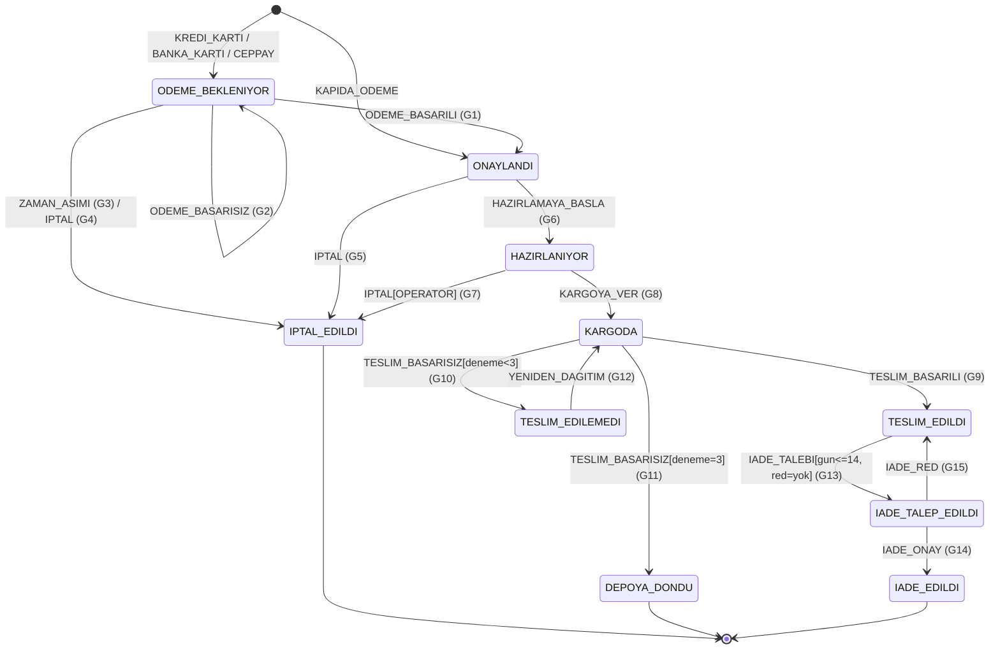

# SFM v1.4 Test Tasarım Dokümanı

| Alan | Değer |
|---|---|
| **Doküman** | Defne Kitap — SFM (Sipariş Fiyatlandırma Motoru) ve Sipariş Durum Yönetimi Test Tasarımı |
| **Referans Spesifikasyon** | `girdiler/SFM-spesifikasyon-v1.4.md` (DK-SPEC-214, Onay: 22.09.2026) |
| **Hazırlayan** | Kıdemli Test Analisti |
| **Hedef Ekip** | Defne Kitap Ödeme ve Sipariş Ekibi (Test Lideri: Selin Aydın) |
| **Durum** | Taslak — Açık sorular (`Q-001`..`Q-012`) ve Ek-A düzeltmesi için PO/BA incelemesi bekleniyor |

---

## 1. Yönetici Özeti ve Teslimat Envanteri

Bu çalışma, henüz kodu geliştirilmemiş **SFM v1.4** fiyatlandırma motoru (`POST /api/v2/sepet/fiyatla`), sipariş durum yaşam döngüsü ve uçtan uca (E2E) ödeme akışı konfigürasyonları için risk tabanlı, kuruş hassasiyetinde doğrulanmış, veri güdümlü test tasarımını içerir.

### Teslimat Dosyaları

| Dosya | Kapsam | Satır / Vaka Sayısı | Doğrulama Durumu |
|---|---|---:|---|
| [`cikti/test-tasarimi.md`](file:///C:/eval/runs/R07/cikti/test-tasarimi.md) | Metodoloji, modeller, analiz bulguları, varsayımlar | 15 REQ / 153 TC izlenebilirliği | RTM & kalite kontrolünden geçti |
| [`cikti/fiyat-test-verisi.csv`](file:///C:/eval/runs/R07/cikti/fiyat-test-verisi.csv) | SFM fiyatlandırma API test vakaları (`TC-001`..`TC-084`) | 84 satır (48 `KABUL`, 36 hata) | `Decimal(ROUND_HALF_UP)` referans motoruyla doğrulandı |
| [`cikti/durum-gecis-testleri.csv`](file:///C:/eval/runs/R07/cikti/durum-gecis-testleri.csv) | Sipariş durum geçiş testleri (`TC-085`..`TC-135`) | 51 satır (27 `KABUL`, 24 hata) | Durum makinesi simülatörüyle (ön koşullar dahil) doğrulandı |
| [`cikti/konfigurasyon-matrisi.csv`](file:///C:/eval/runs/R07/cikti/konfigurasyon-matrisi.csv) | E2E ödeme regresyon matrisi (`TC-136`..`TC-148`) | 13 satır (her biri ~15 dk = 3 sa 15 dk) | 59/59 mümkün 2'li çift (%100) doğrulandı |
| Ek CSV-dışı Tasarım Vakaları (`qa/test-cases.src.md`) | UI kısıtları (KS-1/2/3), çok adımlı sayaç korunumu, eşzamanlılık (`TC-149`..`TC-153`) | 5 vaka | CSV otomasyon şeması dışında kalan E2E/güvenilirlik vakaları |

### Kritik Spesifikasyon Uyarısı

- **Ek-A Örnek 4 Tutarsızlığı (`Q-005`):** Spesifikasyonun Ek-A tablosundaki **Örnek 4** (`KLASIK`, `AT=900,00`, kupon yok, `STANDART`, `UZAK`, `KREDI_KARTI`) satırı `KU = 0,00` ve `OT = 900,00` göstermektedir. Oysa **Bölüm 6.2 ve 6.5** açıkça `NT ≥ 750,00` ücretsiz standart teslimatın yalnızca taban ücreti (39,90 TL) kapsadığını, `UZAK` bölge ek ücretini (25,00 TL) **kapsamadığını** (ek ücreti yalnızca `6.3 ALTIN` avantajının kapsadığını) hükme bağlar. Ek-A notu uyarınca Bölüm 4–8 kuralları geçerli olduğundan doğru beklenen sonuç **`KU = 25.00` ve `OT = 925.00`** olarak tasarlanmıştır (`TC-004`).

### Kalibrasyon ve Kapsam Özeti

- **Gereksinim kapsamı:** `REQ-001`..`REQ-015` olmak üzere **15/15 (%100)** gereksinim kapsanmıştır (13 belirtilen, 2 türetilmiş). Tüm 12 fonksiyonel/iş kuralı gereksiniminin hem pozitif hem negatif testi mevcuttur (`89` pozitif, `64` negatif).
- **Öncelik dağılımı (153 test):** `critical: 20 (%13)`, `high: 51 (%33)`, `medium: 72 (%47)`, `low: 10 (%7)`. Öncelik şişmesi (`PRIORITY_SKEW`) yoktur.
- **Tasarım kalitesi:** Otomatik yazım kalitesi inceleme puanı **100.0/100**, sahipsiz test **0**, kopya test **0**, gereksiz denklik grubu (`REDUNDANT`) **0**.

---

## 2. Test Tasarım Teknikleri ve Gerekçeleri

Gereksinimler `analyzing-requirements` yaklaşımıyla 15 atomik gereksinime ayrılmış, Olasılık × Etki (1–5) skalasıyla risk puanları atanmış ve test derinliği riske göre belirlenmiştir (`3/15 = %20` kritik: `REQ-004`, `REQ-006`, `REQ-007`).

| Teknik | Tasarım Spesifikasyonu | Uygulandığı Alan ve Gerekçe | Kapsam Ölçütü |
|---|---|---|---|
| **Denklik Paylarına Ayırma (EP)** | `DS-001` | Tüm girdi alanlarının geçerli/geçersiz sınıfları (`uyelik`, `kupon`, `teslimat_tipi`, `bolge`, `odeme_yontemi`, `ara_toplam`, `iade_gun`). Geçerli sınıflar birleştirilip geçersiz değerler **tekli hata izolasyonuyla** ayrı test edilmiştir. | 50 tanımlı sınıfın testteki ilgili alt kümesi |
| **3-Değerli Sınır Değer Analizi (3-value BVA)** | `DS-001` | Kritik finansal eşikler (`150.00`, `400.00`, `750.00`, `1500.00`, `20000.00`, `iade_gun 0..14`) için yalnızca `x` ve `x±1` değil, `<=` vs `<` veya `==` hatalarını yakalamak amacıyla sınırın iç komşuları da (`399.98 / 399.99 / 400.00 / 400.01`) test edilmiştir (`bva_scope: valid`). | `ara_toplam` ve `iade_gun` sınırları + komşuları |
| **Alan Testi (Domain Testing — Türetilmiş Sınırlar)** | `DS-001` + Manuel Domain Analizi | Kargo eşiği (`NT ≥ 750.00`) ve kapıda ödeme limiti (`OT = NT + KU + HB ≤ 5000.00`) girdi olan `AT`'ye değil **hesaplanan ara/nihai değişkenlere** bağlıdır. Çok değişkenli ON/OFF sınır noktaları (`AT=799.99/800.00` ile `KITAP50`, `AT=4987.10/4987.11` ve `4962.10/4962.11` ile `KAPIDA_ODEME`) özellikle hedeflenmiştir. | `NT=750` (4 nokta), `OT=5000` (5 nokta) |
| **Karar Tablosu Testi** | `DS-002a`, `DS-002b` | Kupon uygunluğu × sepet aralığı × üyelik (`DS-002a`, 19 sadeleştirilmiş kolon) ve teslimat × bölge × üyelik × NT/OT × ödeme (`DS-002b`, 26 sadeleştirilmiş kolon) etkileşimlerinde kural boşluklarını ve Bölüm 9.3 hata önceliğini doğrulamak için kullanılmıştır. | `DS-002a`: **19/19 (%100)**; `DS-002b`: **26/26 (%100)** |
| **Durum Geçiş Testi (0-switch & 1-switch)** | `DS-003` | Sipariş yaşam döngüsü (`10` durum, `12` olay, `15` geçiş) yüksek iş riski taşıdığı için yalnızca tekil geçişler (`0-switch`) değil, ardışık geçiş çiftleri (`1-switch`), iki farklı başlangıç yolu (`ODEME_BEKLENIYOR` ve `ONAYLANDI`), 3. teslimat sayacı ve geçersiz geçişler modellenmiştir. | Durum **10/10**, Geçiş **15/15**, Mümkün 1-switch **17/17 (%100)** |
| **Pairwise (2-wise) Kombinatoryal Test** | `DS-004` | E2E manuel ödeme regresyonunda kombinasyon başına ~15 dk maliyet nedeniyle 75 geçerli kombinasyon yerine KS-1/2/3 kısıtları altında tüm geçerli ikili etkileşimleri garanti eden en küçük set üretilmiştir. | **13 satır**, mümkün **59/59 (%100)** 2'li çift |
| **Hata Tahminleme (Error Guessing)** | `TC-024`, `TC-052`, `TC-056`, `TC-072..076`, `TC-122`, `TC-124`, `TC-153` | Bankacı yuvarlaması vs yarım-yukarı tuzağı (`200.05 * %10 = 20.005 -> 20.01`), `floor(taban * 1.5)` vs `floor(NT * 0.15)` puan tuzağı (`NT=155 -> 22 vs 23`), `AT=5000.00` kapıda ödeme HB taşma tuzağı, Türkçe ondalık virgül/binlik nokta, bilimsel gösterim (`1e3`) ve çift ödeme callback'i hedeflenmiştir. | 11 hedefli vaka |

---

## 3. Denklik Sınıfları ve Sınır Değerleri

### 3.1 Girdi Parametreleri Denklik Sınıfları (`DS-001`)

| Parametre | Geçerli Sınıflar | Geçersiz Sınıflar (Tekli Hata) |
|---|---|---|
| `uyelik` | `MISAFIR`, `KLASIK`, `ALTIN` | Tanımsız enum (`PLATIN`), boş (`""`) |
| `ara_toplam` | `[150.00, 399.99]` (`KITAP50` altı), `[400.00, 749.99]` (`KITAP50` uygun/kargo altı), `[750.00, 1499.99]` (ücretsiz kargo/`DEFNE10` tavan altı), `[1500.00, 5000.00]` (`DEFNE10` tavan/kapıda civarı), `[5000.01, 20000.00]` (üst aralık) | `<= 0.00` (`0.00`, `-50.00`), `[0.01, 149.99]` (`ERR_MIN_SEPET`), `>= 20000.01` (`ERR_MAX_SEPET`), boş (`""`), 3 ondalık (`150.001`), virgül (`150,00`), binlik ayırıcı (`1.500.00`), sayısal olmayan (`abc`), bilimsel (`1e3`) |
| `kupon` | Boş (`""`), `DEFNE10`, ` DEFNE10 ` (baş/son boşluklu), `KITAP50` *(koşul sağlanmazsa sessiz düşer)* | Küçük harf (`defne10`), tanımsız kod (`YOKKUPON` / `SAHTE`) |
| `teslimat_tipi` | `STANDART`, `HIZLI`, `MAGAZA` | Tanımsız (`AYNI_GUN`), boş (`""`) |
| `bolge` | `NORMAL`, `UZAK` (`STANDART`/`HIZLI` için); `MAGAZA` seçildiğinde boş (`""`) veya `UZAK`/`NORMAL` | `STANDART`/`HIZLI` için boş (`""`), tanımsız (`BILINMEYEN`) |
| `odeme_yontemi` | `KREDI_KARTI`, `BANKA_KARTI`, `KAPIDA_ODEME`, `CEPPAY` *(SFM 3.3 gereği `MISAFIR+CEPPAY` kabul eder)* | Tanımsız (`HAVALE`), boş (`""`) |
| `iade_gun` | Tam sayı `[0, 14]` | `< 0` (`-1` -> `ERR_GECERSIZ_GIRDI`), `> 14` (`15` -> `ERR_IADE_SURESI`), boş, ondalık (`14.5`), sayısal olmayan (`abc`) |

### 3.2 Kritik Sınır Değerleri ve Türetilmiş Alan Sınırları

| Sınır Noktası | Kural | Test Edilen Değerler (OFF / ON / Komşular) | Örnek Test ID'leri |
|---|---|---|---|
| **Min Sepet (`AT ≥ 150.00`)** | Böl. 4.1, 4.3 | `0.00` (`ERR_GECERSIZ_GIRDI`), `149.99` (`ERR_MIN_SEPET`), `150.00`, `150.01`; ayrıca `150.00 + DEFNE10 -> NT=135.00` (`KABUL`) | `TC-070`, `TC-017`..`TC-020` |
| **Max Sepet (`AT ≤ 20000.00`)** | Böl. 4.2, 4.3 | `19999.99`, `20000.00`, `20000.01` (`DEFNE10` sonrası `NT=19850.01` olsa bile `ERR_MAX_SEPET`) | `TC-021`..`TC-023`, `TC-041` |
| **`KITAP50` Eşiği (`AT ≥ 400.00`)** | Böl. 5.4, 5.5 | `399.98` (`KI=0`), `399.99` (`KI=0`, sessiz düşme), `400.00` (`KI=50`), `400.01` (`KI=50`) | `TC-032`..`TC-035` |
| **Yarım-Yukarı Yuvarlama & `DEFNE10` Tavanı (`150.00`)** | Böl. 2.2, 5.3 | `200.04 -> 20.00`, `200.05 -> 20.01` (banker's `20.00` değil!), `1499.94 -> 149.99`, `1499.95 -> 150.00`, `1500.00 -> 150.00`, `1500.05 -> 150.01 -> tavan 150.00` | `TC-024`..`TC-029` |
| **Ücretsiz / İndirimli Kargo (`NT ≥ 750.00`)** | Böl. 6.2, 6.4b | `KITAP50` ile `AT=799.98 (NT=749.98)`, `799.99 (NT=749.99 -> KU=39.90)`, `800.00 (NT=750.00 -> KU=0.00)`, `800.01 (NT=750.01)`; `HIZLI` `749.99 (KU=79.90)` / `750.00 (KU=40.00)` | `TC-044`..`TC-049` |
| **Kapıda Ödeme Limiti (`OT ≤ 5000.00`)** | Böl. 7.3 | `NORMAL`: `4987.10 (+HB 12.90 = 5000.00 -> KABUL)`, `4987.11 (=5000.01 -> ERR_KAPIDA_LIMIT)`, `5000.00 (=5012.90 -> ERR_KAPIDA_LIMIT)`; `UZAK`: `4962.10 (+KU 25 +HB 12.90 = 5000.00)`, `4962.11 (=5000.01)`; kuponlu `5137.10 + DEFNE10 (=5000.00)` | `TC-050`..`TC-055` |
| **Sadakat Puanı (`floor(taban * 1.5)`)** | Böl. 2.3, 8.2–8.3 | `AT=159.99 (KLASIK: 15)`, `AT=155.00 (ALTIN: floor(15*1.5)=22, 23 değil!)`, `NT=850.00 (ALTIN: 127)` | `TC-003`, `TC-056`..`TC-058` |
| **İade Süresi (`gun 0..14`)** | Böl. 10.3, 10.4 | `-1` (`ERR_GECERSIZ_GIRDI`), `0`, `1`, `13`, `14` (`KABUL`), `15` (`ERR_IADE_SURESI`) | `TC-107`..`TC-111`, `TC-121` |

---

## 4. Karar Tabloları

### 4.1 `DS-002a`: Kupon Uygunluğu ve Sepet Limiti Karar Tablosu

- **Özet:** 40 olası kombinasyon · 11 kural · **0 boşluk · 0 çelişki** · 19 sadeleştirilmiş kolon (`D01`–`D19`) · **Kapsam: 19/19 (%100)**. Öncelik sırası `first_match: true` (9.3 sırası: `ERR_KUPON_GECERSIZ > ERR_MIN_SEPET > ERR_MAX_SEPET`).

| Kolon | `kupon` | `at_araligi` | `uyelik` | `durum_hata` | `indirim_kurali` | `kupon_uygulandi` | Örnek TC |
|---|---|---|---|---|---|---|---|
| D01 | `BOS` | `<150` | — | `ERR_MIN_SEPET` | yok | yok | `TC-017` |
| D02 | `BOS` | `150..399.99` | — | `KABUL` | `0.00` | `false` | `TC-018` |
| D03 | `BOS` | `400..1499.99` | — | `KABUL` | `0.00` | `false` | `TC-004` |
| D04 | `BOS` | `1500..20000` | — | `KABUL` | `0.00` | `false` | `TC-021` |
| D05 | `BOS` | `>20000` | — | `ERR_MAX_SEPET` | yok | yok | `TC-066` |
| D06 | `DEFNE10` | `<150` | — | `ERR_MIN_SEPET` | yok | yok | `TC-031` |
| D07 | `DEFNE10` | `150..399.99` | — | `KABUL` | `yuvarla(%10)` | `true` | `TC-030` |
| D08 | `DEFNE10` | `400..1499.99` | — | `KABUL` | `yuvarla(%10)` | `true` | `TC-001` |
| D09 | `DEFNE10` | `1500..20000` | — | `KABUL` | `tavan 150.00` | `true` | `TC-002`, `TC-022` |
| D10 | `DEFNE10` | `>20000` | — | `ERR_MAX_SEPET` | yok | yok | `TC-023` |
| D11 | `KITAP50` | `<150` | — | `ERR_MIN_SEPET` | yok | yok | `TC-040` |
| D12 | `KITAP50` | `150..399.99` | `MISAFIR` | `KABUL` | `0.00` (üyelik + AT<400) | `false` | `TC-036` |
| D13 | `KITAP50` | `150..399.99` | `KLASIK/ALTIN` | `KABUL` | `0.00` (AT<400) | `false` | `TC-033` |
| D14 | `KITAP50` | `400..1499.99` | `MISAFIR` | `KABUL` | `0.00` (üyelik uyumsuz) | `false` | `TC-037` |
| D15 | `KITAP50` | `400..1499.99` | `KLASIK/ALTIN` | `KABUL` | `50.00` sabit | `true` | `TC-003`, `TC-034` |
| D16 | `KITAP50` | `1500..20000` | `MISAFIR` | `KABUL` | `0.00` (üyelik uyumsuz) | `false` | `TC-038` |
| D17 | `KITAP50` | `1500..20000` | `KLASIK/ALTIN` | `KABUL` | `50.00` sabit | `true` | `TC-039` |
| D18 | `KITAP50` | `>20000` | — | `ERR_MAX_SEPET` | yok | yok | `TC-041` |
| D19 | `TANIMSIZ` | — | — | `ERR_KUPON_GECERSIZ` | yok | yok | `TC-043`, `TC-063` |

### 4.2 `DS-002b`: Kargo Ücreti ve Kapıda Ödeme Karar Tablosu

- **Özet:** 108 olası kombinasyon · 22 kural · **0 boşluk · 0 çelişki · sağlama OK** · 26 sadeleştirilmiş kolon (`D01`–`D26`) · **Kapsam: 26/26 (%100)**.

| Kolon | `teslimat` | `bolge` | `uyelik` | `nt_ve_ot` | `odeme` | `durum_hata` | `KU` | `HB` | Örnek TC |
|---|---|---|---|---|---|---|---|---|---|
| D01 | `STANDART` | `NORMAL` | `MISAFIR/KLASIK` | `NT>=750_OT<=5000` | `DIGER` | `KABUL` | `0.00` | `0.00` | `TC-046` |
| D02 | `STANDART` | `NORMAL` | — | `NT>=750_OT<=5000` | `KAPIDA_ODEME` | `KABUL` | `0.00` | `12.90` | `TC-050`, `TC-055` |
| D03 | `STANDART` | `NORMAL` | — | `OT>5000` | `DIGER` | `KABUL` | `0.00` | `0.00` | `TC-021` |
| D04 | `STANDART` | `NORMAL` | — | `OT>5000` | `KAPIDA_ODEME` | `ERR_KAPIDA_LIMIT` | — | — | `TC-051`, `TC-052` |
| D05 | `STANDART` | `NORMAL` | `MISAFIR/KLASIK` | `NT<750` | `DIGER` | `KABUL` | `39.90` | `0.00` | `TC-001`, `TC-007` |
| D06 | `STANDART` | `NORMAL` | `MISAFIR/KLASIK` | `NT<750` | `KAPIDA_ODEME` | `KABUL` | `39.90` | `12.90` | `TC-058` |
| D07 | `STANDART` | `NORMAL` | `ALTIN` | `NT<750` | `DIGER` | `KABUL` | `0.00` | `0.00` | `TC-020`, `TC-056` |
| D08 | `STANDART` | `NORMAL` | `ALTIN` | `NT<750` | `KAPIDA_ODEME` | `KABUL` | `0.00` | `12.90` | `TC-012` |
| D09 | `STANDART` | `UZAK` | — | `OT>5000` | `KAPIDA_ODEME` | `ERR_KAPIDA_LIMIT` | — | — | `TC-054` |
| D10 | `STANDART` | `UZAK` | `MISAFIR/KLASIK` | `NT<750` | `DIGER` | `KABUL` | `64.90` | `0.00` | `TC-010` |
| D11 | `STANDART` | `UZAK` | `MISAFIR/KLASIK` | `NT<750` | `KAPIDA_ODEME` | `KABUL` | `64.90` | `12.90` | `TC-011` |
| D12 | `STANDART` | `UZAK` | `MISAFIR/KLASIK` | `NT>=750_OT<=5000` | `DIGER` | `KABUL` | `25.00` | `0.00` | `TC-004` *(Ek-A düzeltmesi)* |
| D13 | `STANDART` | `UZAK` | `MISAFIR/KLASIK` | `NT>=750_OT<=5000` | `KAPIDA_ODEME` | `KABUL` | `25.00` | `12.90` | `TC-053` |
| D14 | `STANDART` | `UZAK` | `MISAFIR/KLASIK` | `OT>5000` | `DIGER` | `KABUL` | `25.00` | `0.00` | `TC-015` |
| D15 | `STANDART` | `UZAK` | `ALTIN` | — | `DIGER` | `KABUL` | `0.00` | `0.00` | `TC-008` |
| D16 | `STANDART` | `UZAK` | `ALTIN` | `NT<750` | `KAPIDA_ODEME` | `KABUL` | `0.00` | `12.90` | `TC-013` |
| D17 | `STANDART` | `UZAK` | `ALTIN` | `NT>=750_OT<=5000` | `KAPIDA_ODEME` | `KABUL` | `0.00` | `12.90` | `TC-014` |
| D18 | `STANDART` | `BOS` | — | — | — | `ERR_GECERSIZ_GIRDI` | — | — | `TC-080` |
| D19 | `HIZLI` | `NORMAL` | — | `NT<750` / `<=5000` | `KAPIDA_ODEME` | `ERR_KAPIDA_UYGUNLUK` | — | — | `TC-060`, `TC-068` |
| D20 | `HIZLI` | `NORMAL` | — | `NT<750` | `DIGER` | `KABUL` | `79.90` | `0.00` | `TC-009`, `TC-048` |
| D21 | `HIZLI` | `NORMAL` | — | `NT>=750_OT<=5000` | `DIGER` | `KABUL` | `40.00` | `0.00` | `TC-002`, `TC-049` |
| D22 | `HIZLI` | `NORMAL` | — | `OT>5000` | `DIGER` | `KABUL` | `40.00` | `0.00` | `TC-016` |
| D23 | `HIZLI` | `UZAK` | — | — | — | `ERR_TESLIMAT_BOLGE` | — | — | `TC-059`, `TC-067` |
| D24 | `HIZLI` | `BOS` | — | — | — | `ERR_GECERSIZ_GIRDI` | — | — | `TC-081` |
| D25 | `MAGAZA` | — | — | — | `DIGER` | `KABUL` | `0.00` | `0.00` | `TC-005`, `TC-006` |
| D26 | `MAGAZA` | — | — | — | `KAPIDA_ODEME` | `ERR_KAPIDA_UYGUNLUK` | — | — | `TC-061` |

### 4.3 Bölüm 9.3 Hata Öncelik Sırası Çiftleri

Hata önceliği (`1. ERR_GECERSIZ_GIRDI > 2. ERR_KUPON_GECERSIZ > 3. ERR_MIN_SEPET > 4. ERR_MAX_SEPET > 5. ERR_TESLIMAT_BOLGE > 6. ERR_KAPIDA_UYGUNLUK > 7. ERR_KAPIDA_LIMIT`) `TC-062`..`TC-068` ve `TC-082` ile bitişik tüm katmanlarda doğrulanmıştır (`#1>#2`, `#1>#5`, `#2>#3`, `#2>#4`, `#3>#5/#6`, `#4>#5/#6/#7`, `#5>#6`, `#6>#7`).

---

## 5. Durum Geçiş Modeli (`DS-003`)

### 5.1 Yaşam Döngüsü Diyagramı

### 5.2 Model Analiz Bulguları ve Geçiş Kapsamı

- **Başlangıç durumları:** `KREDI_KARTI`, `BANKA_KARTI`, `CEPPAY` ile `ODEME_BEKLENIYOR` (`TC-085..087`); `KAPIDA_ODEME` ile doğrudan `ONAYLANDI` (`TC-088`, ayrıca `G5`, `G6`, `G9` devamları `TC-097`, `TC-098`, `TC-102`).
- **0-switch kapsamı:** 15/15 geçiş (`G1`–`G15`) ve 10/10 durum (%100) kapsanmıştır.
- **1-switch kapsamı ve koşul engelli çiftler:** Statik grafikte 19 adet `(Gi, Gj)` geçiş çifti vardır. Bunlardan **17/17 (%100) mümkün çift** test edilmiştir. Diğer 2 statik çift çalışma zamanı koşulları nedeniyle **olanaksızdır**:
  1. `G15 -> G13` (`IADE_RED -> IADE_TALEBI`): Aynı siparişte ikinci iade talebi G13 koşulu gereği yasaktır; bu çiftin **negatif testi** `TC-114` (`ERR_IADE_TEKRAR`) ve `TC-115` (`ERR_IADE_SURESI` önceliği) ile doğrulanır.
  2. `G8 -> G11` (`KARGOYA_VER -> 3. TESLIM_BASARISIZ`): Kargoya çıkışta başarısız deneme sayacı `0`'dır; ilk `TESLIM_BASARISIZ` her zaman `G10` (`deneme=1 < 3`) kolunu alır. `G11` yalnızca `G12` (`YENIDEN_DAGITIM`) sonrası 3. denemede gerçekleşebilir (`TC-106`).
- **Geçersiz geçişler ve Bölüm 10.5 işleme sırası:**
  - `10 × 12 = 120` `(durum, olay)` hücresinden `106` tanesinde geçiş yoktur (`DS-003 N-01`..`N-106`). Her ulaşılabilir durum ve 3 son durum (`IPTAL_EDILDI`, `DEPOYA_DONDU`, `IADE_EDILDI`) için en yüksek riskli geçersiz geçişler (`TC-125`..`TC-135`, ayrıca `G7` `MUSTERI` iptali `TC-100`) test edilmiştir.
  - Bölüm 10.5'in 5 adımlı sırası (`1. tanımsız olay -> ERR_GECERSIZ_GIRDI`, `2. duruma uygunsuz olay -> ERR_GECERSIZ_GECIS`, `3. parametre eksik/geçersiz -> ERR_GECERSIZ_GIRDI`, `4. koşul hatası: önce ERR_IADE_SURESI sonra ERR_IADE_TEKRAR`, `5. hata anında durum ve sayaç korunumu`) `TC-114`..`TC-124` ve çok adımlı `TC-151`, `TC-152` ile tam kapsanmıştır (`TC-111`..`TC-135` ve `TC-100` dahil toplam 24 CSV hata vakası).
  - **Önemli Runner Sözleşmesi Notu:** `TASK.md` gereği `durum-gecis-testleri.csv` satırlarında yalnızca **son olay** hata üretebilir, önceki olayların hepsi `KABUL` olmalıdır. Bu nedenle hata sonrası sayacın korunduğunu kanıtlayan çok adımlı senaryolar (`TC-151` teslim sayacı korunumu, `TC-152` süre aşımı sonrası iade hakkı korunumu) CSV dışı çok adımlı API vakaları olarak tasarlanmıştır.

---

## 6. E2E Konfigürasyon Kombinasyonlarına Yaklaşım (`DS-004`)

### Boyut ve Süre Maliyeti Analizi

| Yaklaşım | Kombinasyon Sayısı | Tahmini Manuel Süre (~15 dk/test) | Açıklama |
|---|---:|---:|---|
| Tam Kartezyen (`3 × 4 × 3 × 3`) | 108 | 27 sa 00 dk | Kısıtlar (`KS-1`, `KS-2`, `KS-3`) nedeniyle 33 tanesi olanaksızdır. |
| Kısıtlar Sonrası Tüm Geçerli | 75 | 18 sa 45 dk | Her regresyonda manuel koşum için bütçe dışı (~2.5 iş günü). |
| 3-wise (`strength = 3`) | 39 | 9 sa 45 dk | 112 üçlüyü kapsar ancak 1 iş gününü aşar. |
| **Seçilen: 2-wise Pairwise (`strength = 2`)** | **13** | **3 sa 15 dk** | **Mümkün 59 adet 2'li çiftin %100'ünü kapsar (%88.0 toplam azalma, geçerli setten %82.7 azalma).** |

### Uygulanan Kısıtlar (`11.2`) ve Tamamlayıcı Kapsam

- **Kısıtlar (`forbidden`):**
  - `KS-1`: `KAPIDA_ODEME` + `HIZLI` veya `MAGAZA` hariç tutuldu (18 geçersiz kombinasyon).
  - `KS-2`: `WEB` + `CEPPAY` hariç tutuldu (9 geçersiz kombinasyon).
  - `KS-3`: `MISAFIR` + `CEPPAY` hariç tutuldu (kalan 6 geçersiz kombinasyon).
- **Seed Test:** En yüksek üretim trafiğini temsil eden `WEB + KREDI_KARTI + STANDART + KLASIK` satırı (`TC-136`) başlangıç testi olarak matrise sabitlenmiştir (`pairwise.py`, `seed=7`).
- **Ekran Kısıtı Negatif Doğrulaması:** Pairwise matrisi yalnızca geçerli konfigürasyonların E2E başarıyla tamamlandığını doğrular. Ödeme ekranının `KS-1`, `KS-2` ve `KS-3` kısıtlarını gerçekten engellediği ise `TC-149` ve `TC-150` negatif UI vakalarıyla ayrı doğrulanmalıdır.

---

## 7. Spesifikasyonla İlgili Soru, Tutarsızlık ve Tespitler

| ID | Öncelik / Önem | İlgili Alan | Tespit / Soru | Seçenekler ve Önerilen Düzeltme |
|---|---|---|---|---|
| **Q-005** | **Kritik (Çelişki)** | Ek-A Örnek 4 vs Böl. 6.2 & 6.5 | Ek-A Örnek 4 (`KLASIK`, `AT=900,00`, `STANDART`, `UZAK`) satırında `KU=0,00`, `OT=900,00` yazıyor; ancak 6.2 & 6.5 `UZAK` ek ücretini (25,00 TL) yalnızca `ALTIN` üyeye muaf tutar. | Bölüm 6 geçerlidir (`KU=25,00`, `OT=925,00`). Ek-A Örnek 4 yayın öncesi düzeltilmelidir (`TC-004`). |
| **Q-001** | Önemli | Böl. 3 (`MAGAZA` & `bolge`) | `MAGAZA` seçildiğinde `bolge` "dikkate alınmaz ve doğrulanmaz (boş olabilir)" deniyor. `MAGAZA` ile `bolge="BILINMEYEN"` gönderilirse yok mu sayılacak, `ERR_GECERSIZ_GIRDI` mi dönecek? | a) Tamamen yok sayılır b) Boş/null/`NORMAL`/`UZAK` kabul edilir, tanımsız metin reddedilir. Şema kuralı netleştirilmeli. |
| **Q-002** | Önemli | Böl. 3, 3.1, 4.1 | `ara_toplam = 0.00` / `-50.00` değerleri `ERR_GECERSIZ_GIRDI` mi yoksa `ERR_MIN_SEPET` mi döner? Tam sayı (`150`) ve maksimum basamak/overflow sınırı nedir? | Böl. 3 ("0'dan büyük") + 3.1 + 9.3 gereği `<=0` -> `ERR_GECERSIZ_GIRDI`, `0.01..149.99` -> `ERR_MIN_SEPET` alınmıştır (`TC-070`, `TC-071`). Ondalıksız `150` ve max tutar sınırı teyit edilmeli. |
| **Q-003** | Önemli | Böl. 5.2 | Baştaki/sondaki boşluklar kırpılırken yalnızca boşluk içeren `"   "` kupon değeri "kupon yok" (`""`) mu sayılacak, yoksa `ERR_KUPON_GECERSIZ` mi dönecek? Kupon max uzunluğu nedir? | Kırpma sonrası boş (`KI=0,00`) vs `ERR_KUPON_GECERSIZ` kararı PO/Dev tarafından netleştirilmeli. |
| **Q-004** | Önemli (Şablon Uyumu) | Böl. 9.1 & CSV Şablonu | API yanıtı `kupon_uygulandi` (boolean) alanını dönerken `fiyat-test-verisi.csv` şablonunda `beklenen_kupon_uygulandi` kolonu yoktur. | Otomasyon bu alanı şablona ekleyecek mi yoksa `beklenen_kupon_indirimi > 0` üzerinden mi doğrulayacak? Şablon kilitli olduğu için `aciklama` sütununda belirtilmiştir. |
| **Q-006** | Önemli (Eksiklik) | Böl. 3/6 & Böl. 10 | `MAGAZA` (mağazadan teslim al) siparişleri için Bölüm 10'da özel durum/olay (`MAGAZAYA_ULASTI`, mağazada bekleme zaman aşımı vb.) yoktur. | `MAGAZA` siparişleri de `KARGOYA_VER -> KARGODA -> TESLIM_BASARILI` akışını mı izleyecek? Ops/PO teyidi gerekir. |
| **Q-007** | Önemli | Böl. 10.4 (G2) | `ODEME_BASARISIZ` için maksimum tekrar deneme limiti belirtilmemiştir (yalnızca 30 dk `ZAMAN_ASIMI` var). | Sınırsız deneme mi yoksa N başarısız denemeden sonra otomatik iptal/bloke mi uygulanacak? |
| **Q-008** | Önemli | Böl. 10.4 & 10.6 | `TESLIM_EDILEMEDI` durumundayken müşteri siparişi iptal etmek isterse 3. teslim denemesinin başarısız olup `DEPOYA_DONDU` olmasını mı bekleyecek? Şubede bekleme zaman aşımı var mı? | `TESLIM_EDILEMEDI` durumunda `IPTAL` -> `ERR_GECERSIZ_GECIS` uygulanmıştır (`TC-129`). İş ihtiyacı Ops/PO ile doğrulanmalı. |
| **Q-009** | Önemli (Mevzuat) | Böl. 10.3 & 10.4 (G13) | 14 günlük iade süresi UTC+3 takvim günü mü yoksa `14×24` saat mi? İptal/iade sonrası `HB` (12,90 TL), `KU`, kupon kullanım hakkı ve sadakat puanı iadesi nasıl işleyecek? | 01.01.2026 yürürlüklü Mesafeli Sözleşmeler Yönetmeliği değişikliği (taşıyıcı bilgisi ve ücretsiz iade) çerçevesinde finansal iade kuralları netleştirilmelidir. |
| **Q-010** | Önemli (Uygulama Riski) | Böl. 10.5 | 10.5 sırasına göre Adım 2 (`ERR_GECERSIZ_GECIS`), Adım 3'ten (`ERR_GECERSIZ_GIRDI` - parametre doğrulaması) önce gelir. Örneğin `KARGODA` iken `IPTAL(aktor=ADMIN)` -> `ERR_GECERSIZ_GECIS` döner (`TC-118`). Ayrıca parametresiz olaylara fazladan parametre gelirse ne olur? | Geliştiriciler sıklıkla DTO şema doğrulamasını (Adım 3) önce yazar; 10.5 sırasının kasıtlı olduğu geliştirme öncesi teyit edilmelidir. |
| **Q-011** | Önemli | Böl. 11.1 & 3.3 | E2E matris faktörlerinde `bolge` (`NORMAL`, `UZAK`) yer almamaktadır. Ayrıca 3.3 gereği SFM `MISAFIR + CEPPAY`'i API'de engellemez (`TC-007`). | Manuel E2E testlerde `bolge=NORMAL` varsayılıp `UZAK` bölge farkı SFM API/ek senaryo ile, `KS-1/2/3` ise ayrı negatif UI testleriyle (`TC-149`, `TC-150`) kapsanmıştır. |
| **Q-012** | Küçük (Güvenilirlik) | Böl. 10.4 (Türetilmiş `REQ-015`) | Çift `ODEME_BASARILI` webhook'u veya 30. dk `ZAMAN_ASIMI` yarışı durumunda 2. çağrı `ERR_GECERSIZ_GECIS` mi dönecek yoksa idempotent `KABUL` mü? | Katı durum makinesi gereği `ERR_GECERSIZ_GECIS` varsayılmıştır (`TC-153`); ödeme sağlayıcı entegrasyonuna göre netleştirilmelidir. |

---

## 8. Varsayımlar

1. **Bölüm 4–8 önceliği (`Q-005`):** Ek-A Örnek 4 ile Bölüm 6 arasındaki çelişkide Bölüm 6.2 & 6.5 esas alınmıştır (`TC-004`).
2. **Sıfır/Negatif `ara_toplam` (`Q-002`):** `ara_toplam <= 0.00` girdi biçim/tanım ihlali kabul edilip `ERR_GECERSIZ_GIRDI` beklenmiştir (`TC-070`, `TC-071`); `0.01..149.99` aralığı `ERR_MIN_SEPET` olarak ayrılmıştır.
3. **10.5 Doğrulama Sırası (`Q-010`):** Olay işleme kuralları spesifikasyondaki yazılı sırayla (1→2→3→4→5) uygulanır; parametresiz olaylara fazladan parametre verilmesi Adım 3 kapsamında `ERR_GECERSIZ_GIRDI` sayılmıştır.
4. **Tam Sayı `gun` (`Q-009`):** `IADE_TALEBI(gun=n)` için `gun` değeri negatif olmayan tam sayı (`0, 1, ..., 14`) olarak alınmış, ondalık (`14.5`) ve metin (`abc`) geçersiz girdi sayılmıştır.
5. **E2E Konfigürasyonda Sabit Koşullar (`Q-011`):** `konfigurasyon-matrisi.csv` satırlarının manuel koşumunda sepet tutarı `500.00` TL, bölge `NORMAL` ve kuponsuz temel akış varsayılmıştır; fiyat ve bölge varyasyonları `fiyat-test-verisi.csv` ile bağımsız doğrulanır.

---

## 9. Kapsam Dışı Bırakılanlar ve Gerekçeleri

1. **Spesifikasyon Bölüm 1 kapsam dışı alanları:** Stok kontrolü, ürün bazlı kampanyalar, e-arşiv/e-fatura oluşturma, puanların hesaba geçmesi ve harcanması, gerçek kargo firması entegrasyonu test kapsamı dışındadır.
2. **Belirsiz/onaysız uç girdi yorumları:** `kupon="   "` (yalnızca boşluk, `Q-003`) ve `MAGAZA` + `bolge="BILINMEYEN"` (`Q-001`) senaryoları, spesifikasyon açık bir oracle tanımlamadığından yanlış otomasyon alarmı üretmemek için CSV veri dosyasına konmamış, netleştirme sorusu olarak raporlanmıştır.
3. **Tüm 106 geçersiz durum geçiş hücresi:** `DS-003` durum tablosundaki 106 geçersiz `(durum, olay)` hücresinin tamamı yerine her ulaşılabilir durumdan ve her son durumdan iş riski taşıyan temsili geçersiz geçişler ve olay/parametre/koşul hataları (24 CSV hata vakası) seçilmiştir; kalan mekanik kombinasyonlar durum makinesi birim testleri veya düşük riskli ek regresyon olarak ertelenmiştir.
4. **3-wise E2E konfigürasyon seti (39 kombinasyon):** Manuel koşum süresi `9 saat 45 dakika` olacağından bütçe dengesiyle 2-wise (13 kombinasyon = `3 saat 15 dakika`) seçilmiştir.
5. **Fonksiyonel olmayan (NFR) performans, erişilebilirlik ve kapsamlı güvenlik taramaları:** Yük/stres eşikleri, WCAG 2.2 erişilebilirlik (Türkiye 2025/10 Genelgesi uyumu) ve KVKK/PCI-DSS denetimleri spesifikasyonda hedef metrik bulunmadığından bu fazın kapsamı dışında tutulmuştur.
