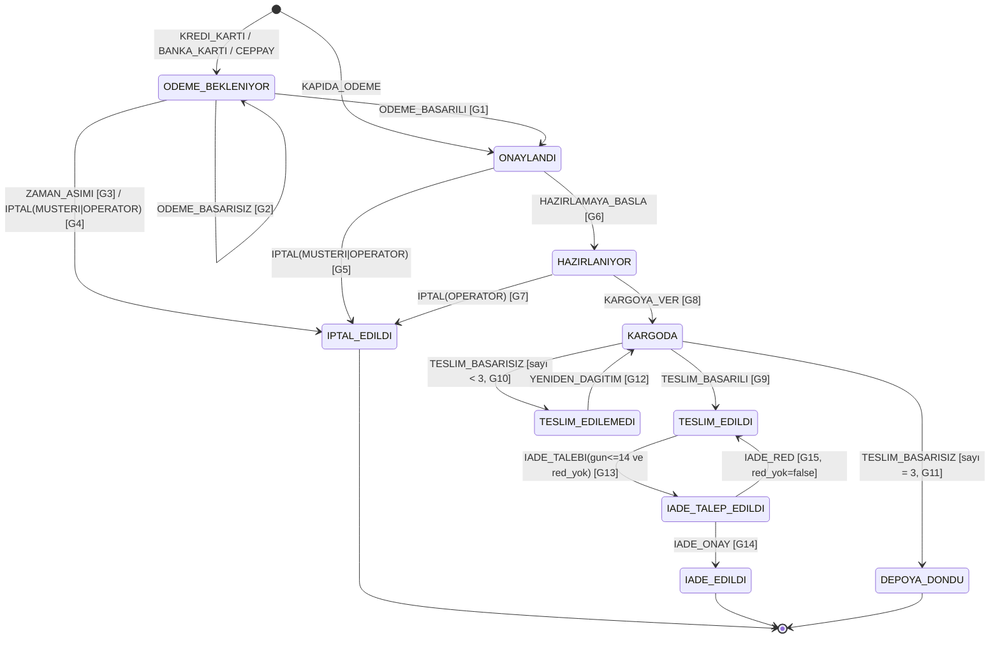

# SFM v1.4 ve Sipariş Durum Yönetimi — Test Tasarım Dokümanı

**Proje / Modül:** Defne Kitap — Sipariş Fiyatlandırma Motoru (SFM) v1.4, Sipariş Durum Yönetimi ve E2E Ödeme Akışı  
**Kaynak Spesifikasyon:** `girdiler/SFM-spesifikasyon-v1.4.md` (Doküman No: DK-SPEC-214, Onay Tarihi: 22.09.2026)  
**Hazırlayan:** Kıdemli Test Analisti  
**Hedef Kitle:** Ödeme ve Sipariş Ekibi (Test Lideri, Geliştirme ve Otomasyon Ekibi)

---

## 1. Yönetici Özeti ve Teslimat Envanteri

Bu test tasarımı, henüz kodu yazılmamış SFM v1.4 ve sipariş yaşam döngüsü için geliştirmeye paralel koşulabilecek, deterministik ve kuruş hassasiyetinde doğrulanmış bir test paketi sunar. Tasarımın temel hedefi; düşük vaka sayısıyla yüksek hata yakalama gücü elde etmek, geçen sürümde yaşanan hatalı beklenen değer kaynaklı yanlış alarmları (false positive) önlemek ve spesifikasyondaki çelişki/belirsizlikleri geliştirme başlamadan görünür kılmaktır.

| Teslimat Dosyası | Kapsam | Vaka / Satır Sayısı | Uygulanan Temel Teknikler |
|---|---|---:|---|
| `cikti/fiyat-test-verisi.csv` | SFM (`POST /api/v2/sepet/fiyatla`) fiyatlama, yuvarlama, limit ve hata öncelikleri | 65 test vakası (`SFM-01` – `SFM-65`) | Denklik Sınıfları (EP), Sınır Değer Analizi (BVA), Karar Tablosu, Hata Öncelik Çiftleme |
| `cikti/durum-gecis-testleri.csv` | Sipariş durum yaşam döngüsü, sayaçlar, aktör/gün koşulları ve hata kuralları | 52 test vakası (`DGT-01` – `DGT-52`) | Durum Geçiş Testi (1-switch & 2-switch), N-switch / Geçersiz Geçiş Matrisi, Sınır Değer Analizi |
| `cikti/konfigurasyon-matrisi.csv` | E2E ödeme regresyon kombinasyonları (manuel ~15 dk/vaka) | 13 kombinasyon (`KONF-01` – `KONF-13`) | Kısıtlı Çiftli (Constrained Pairwise) Test + Risk Bazlı Duman (Smoke) Vakası |
| `cikti/test-tasarimi.md` | Metodoloji, modeller, spesifikasyon bulguları, varsayımlar ve kapsam sınırları | — | Analiz ve İzlenebilirlik Dokümantasyonu |

---

## 2. Test Teknikleri ve Gerekçeleri

Her alt sistemin risk profili ve kural yapısına göre farklı test tasarım teknikleri seçilmiştir:

1. **Denklik Sınıfları Bölümleme (Equivalence Partitioning — EP):**
   - *Neden:* `uyelik`, `teslimat_tipi`, `bolge`, `odeme_yontemi` ve `kupon` alanları sonlu ayrık değer kümelerine sahiptir. Geçerli ve geçersiz girdi sınıflarını ayırarak gereksiz tekrarı önler. Örneğin `KREDI_KARTI`, `BANKA_KARTI` ve `CEPPAY` fiyatlandırma açısından aynı sınıftadır (Madde 3.3); yine de bu eşitliğin gerçekten sağlandığını doğrulamak için her biri en az bir vakada kullanılmıştır (`SFM-13`, `SFM-14`, `SFM-43`, `SFM-47`).
2. **Sınır Değer Analizi (Boundary Value Analysis — BVA — 2 ve 3 noktalı):**
   - *Neden:* Spesifikasyon çok sayıda kritik eşik değeri içerir: `ara_toplam > 0`, `150.00 TL` ve `20000.00 TL` sepet limitleri, `400.00 TL` (`KITAP50`), `750.00 TL` (`NT` üzerinden ücretsiz kargo/hızlı indirim eşiği), `150.00 TL` (`DEFNE10` tavanı ve yarım yukarı yuvarlama sınırı), `5000.00 TL` (`OT` kapıda ödeme limiti) ve iade süresi `0`–`14` gün sınırları. Hataların büyük çoğunluğu `<` vs `<=`, yuvarlama yönü (`15.004` vs `15.005`) ve limitin `AT` mi `NT` mi `OT` üzerinden mi kontrol edildiği noktalarında çıkar.
3. **Karar Tablosu (Decision Table):**
   - *Neden:* Kargo ücreti (`KU`) ve hizmet bedeli (`HB`), tek başına bir değişkene değil; `uyelik`, `teslimat_tipi`, `bolge`, `NT >= 750` ve `odeme_yontemi` faktörlerinin kombinasyonuna bağlıdır. Özellikle `ALTIN` üyeliğin `STANDART + UZAK` ücretini kaldırırken `HIZLI` veya `HB = 12.90` ücretini kaldırmaması gibi çapraz etkileşimler karar tablosu olmadan kolayca atlanır.
4. **Hata Öncelik Zinciri Testi (Error Priority Pairwise):**
   - *Neden:* Madde 9.3 ve 10.5 katı hata öncelik sıraları tanımlar. Aynı anda birden fazla hata tetikleyen girdiler gönderilerek her komşu öncelik çifti (`1>2`, `2>3`, `2>4`, `3>5`, `4>5`, `5>6`, `6>7`; durum makinesinde `10.5.1 > 10.5.2 > 10.5.3 > 10.5.4`) doğrulanmıştır.
5. **Durum Geçiş Testi (State Transition Testing — Durum Ağacı & Geçiş Matrisi):**
   - *Neden:* Bölüm 10, 10 durum, 12 olay, 15 geçerli geçiş, 3 son durum ve gizli durum değişkenleri (`basarisiz_teslim_sayisi` ve `onceki_iade_reddedildi`) içerir. Tüm geçerli geçişlerin %100 kapsamı (G1–G15), çok adımlı döngüler (`ODEME_BASARISIZ` tekrarı, 3. denemede teslim vs. `DEPOYA_DONDU`, `IADE_RED` sonrası tekrar engeli) ve her durum için yasak geçişlerin reddedilmesi (`ERR_GECERSIZ_GECIS`) sistematik olarak modellenmiştir.
6. **Kısıtlı Çiftli (Pairwise / 2-wise) Kombinatorik Tasarım:**
   - *Neden:* E2E ödeme akışında 4 faktörün tam kartezyen çarpımı `108`, kısıtlar sonrası geçerli uzayı `75` konfigürasyondur. Manuel koşum süresi (15 dk/konfigürasyon) nedeniyle `75 × 15 dk = 18 saat 45 dk` sürdürülebilir değildir. Kısıtları (`KS-1`, `KS-2`, `KS-3`) ihlal etmeyen **59 geçerli ikili etkileşimin %100'ü** teorik alt sınır olan 12 kombinasyonla kapatılmış, üzerine en kritik üretim akışı (`WEB + KREDI_KARTI + STANDART + KLASIK`) risk bazlı duman vakası olarak eklenerek **13 satırlık (3 saat 15 dk)** matris oluşturulmuştur.

---

## 3. SFM Fiyatlandırma: Denklik Sınıfları ve Sınır Değerleri

### 3.1 Girdi Alanlarının Denklik Sınıfları

| Alan | Geçerli Sınıflar | Geçersiz Sınıflar (Beklenen Hata) | Örnek Test ID'leri |
|---|---|---|---|
| `uyelik` | `MISAFIR`, `KLASIK`, `ALTIN` | Tanımsız değer (`PLATIN`), boş (`""`) → `ERR_GECERSIZ_GIRDI` | `SFM-01`, `SFM-02`, `SFM-17`, `SFM-25`, `SFM-34` |
| `ara_toplam` | `(0.00, 150.00)` (min altı), `[150.00, 20000.00]` (kabul), `(20000.00, ∞)` (max üstü); en fazla 2 ondalık, nokta ayraçlı | `<= 0` (`0.00`, `-10.00`), 3+ ondalık (`250.005`), virgül (`250,00`), boş (`""`) → `ERR_GECERSIZ_GIRDI` | `SFM-03`..`SFM-07`, `SFM-15`..`SFM-22` |
| `kupon` | Boş (`""`), `DEFNE10`, `KITAP50`, baş/son boşluklu tanımlı kod (`"  DEFNE10  "`) | Tanımsız kod (`SAHTE10`), büyük/küçük harf uyumsuz (`defne10`, `kitap50`) → `ERR_KUPON_GECERSIZ` | `SFM-23`..`SFM-34` |
| `teslimat_tipi` | `STANDART`, `HIZLI`, `MAGAZA` | Tanımsız değer (`EXPRESS`) → `ERR_GECERSIZ_GIRDI` | `SFM-08`, `SFM-13`, `SFM-43` |
| `bolge` | `STANDART`/`HIZLI` için `{NORMAL, UZAK}`; `MAGAZA` için boş veya herhangi bir değer (dikkate alınmaz) | `STANDART`/`HIZLI` için boş (`""`) veya tanımsız (`ADA`) → `ERR_GECERSIZ_GIRDI`; `HIZLI` + `UZAK` → `ERR_TESLIMAT_BOLGE` | `SFM-09`..`SFM-11`, `SFM-13`, `SFM-14`, `SFM-46` |
| `odeme_yontemi` | `KREDI_KARTI`, `BANKA_KARTI`, `CEPPAY` (`HB=0`), `KAPIDA_ODEME` (`HB=12.90`, yalnızca `STANDART`) | Tanımsız değer (`HAVALE`) → `ERR_GECERSIZ_GIRDI`; `KAPIDA_ODEME` + `HIZLI`/`MAGAZA` → `ERR_KAPIDA_UYGUNLUK`; `OT > 5000` → `ERR_KAPIDA_LIMIT` | `SFM-12`, `SFM-47`..`SFM-56` |

### 3.2 Kritik Sınır Değerleri (BVA)

| Kural / Değişken | Eşik | Sınır Altı | Tam Sınır | Sınır Üstü | İlgili Testler |
|---|---|---|---|---|---|
| `ara_toplam > 0` (format/değer) | `0.00` | `-10.00` (`ERR_GECERSIZ_GIRDI`) | `0.00` (`ERR_GECERSIZ_GIRDI`) | `0.01` (`ERR_MIN_SEPET`) | `SFM-03`, `SFM-04`, `SFM-15` |
| Minimum sepet (`AT >= 150.00`) | `150.00` | `149.99` (`ERR_MIN_SEPET`) | `150.00` (`KABUL`; `DEFNE10` ile `NT=135` da `KABUL`) | `150.04` (`KABUL`) | `SFM-16`, `SFM-17`, `SFM-18` |
| Maksimum sepet (`AT <= 20000.00`) | `20000.00` | — | `20000.00` (`KABUL`) | `20000.01` (`ERR_MAX_SEPET`, kuponla `NT<20000` olsa bile) | `SFM-19`..`SFM-22` |
| Yarım yukarı yuvarlama (`DEFNE10`) | `.xx5` | `150.04` (`15.004 → 15.00`) | `150.05` (`15.005 → 15.01`, banker yuvarlamasından ayrılır) | — | `SFM-26`, `SFM-27` |
| `DEFNE10` tavanı (`150.00 TL`) | `150.00` | `1499.94` (`149.994 → 149.99`) | `1499.95` (`149.995 → 150.00`, Madde 2.2) | `1500.05` (`150.005 → 150.01 → 150.00`) | `SFM-28`, `SFM-29`, `SFM-30` |
| `KITAP50` alt eşiği (`AT >= 400.00`) | `400.00` | `399.99` (`KI=0.00`, `kupon_uygulandi=false`) | `400.00` (`KI=50.00`, `KLASIK`/`ALTIN`) | — | `SFM-32`, `SFM-33`, `SFM-34` |
| Kargo eşiği (`NT >= 750.00`, `KITAP50`) | `750.00` | `AT=799.99 → NT=749.99` (`KU=39.90`) | `AT=800.00 → NT=750.00` (`KU=0.00`) | — | `SFM-36`, `SFM-37` |
| Kargo eşiği (`NT >= 750.00`, `DEFNE10`) | `750.00` | `AT=833.32 → NT=749.99` (`KU=39.90`) | `AT=833.33 → NT=750.00` (`KU=0.00`) | — | `SFM-38`, `SFM-39` |
| Hızlı kargo eşiği (`NT >= 750.00`) | `750.00` | `749.99` (`KU=79.90`) | `750.00` (`KU=40.00`) | — | `SFM-44`, `SFM-45` |
| Kapıda ödeme limiti (`OT <= 5000.00`, `NORMAL`) | `5000.00` | — | `AT=4987.10` (`OT=5000.00`, `KABUL`) | `AT=4987.11` (`OT=5000.01`, `ERR_KAPIDA_LIMIT`) | `SFM-51`, `SFM-52` |
| Kapıda ödeme limiti (`OT <= 5000.00`, `UZAK`) | `5000.00` | — | `AT=4962.10` (`+25+12.90=5000.00`, `KABUL`) | `AT=4962.11` (`OT=5000.01`, `ERR_KAPIDA_LIMIT`) | `SFM-53`, `SFM-54` |
| Kapıda ödeme limiti (`AT > 5000`, kuponlu `OT`) | `5000.00` | — | `AT=5137.10 + DEFNE10` (`OT=5000.00`, `KABUL`) | `AT=5137.11 + DEFNE10` (`OT=5000.01`, `ERR_KAPIDA_LIMIT`) | `SFM-55`, `SFM-56` |
| Puan tabanı ve `ALTIN` çarpanı | `10 TL`, `×1.5` | `159.99` (`taban=15`) | `158.00` (`ALTIN`: `floor(15×1.5)=22`, `23` değil) | — | `SFM-57`, `SFM-58` |

---

## 4. Karar Tabloları

### 4.1 Kupon Uygulanabilirlik ve Hesaplama Karar Tablosu

| Koşul / Kural | K1 | K2 | K3 | K4 | K5 | K6 | K7 |
|---|---|---|---|---|---|---|---|
| `kupon` (kırpılmış) | `""` | Tanımsız / küçük harf | `DEFNE10` | `DEFNE10` | `KITAP50` | `KITAP50` | `KITAP50` |
| `uyelik` | Herhangi | Herhangi | Herhangi | Herhangi | `MISAFIR` | `KLASIK`/`ALTIN` | `KLASIK`/`ALTIN` |
| `AT >= 400.00` | — | — | — | — | — | Hayır (`<400`) | Evet (`>=400`) |
| `round_half_up(AT * 0.10) > 150.00` | — | — | Hayır | Evet | — | — | — |
| **Sonuç / Durum** | `KABUL` | `ERR_KUPON_GECERSIZ` | `KABUL` | `KABUL` | `KABUL` | `KABUL` | `KABUL` |
| **`kupon_indirimi` (`KI`)** | `0.00` | — | `round(AT×0.10)` | `150.00` | `0.00` | `0.00` | `50.00` |
| **`kupon_uygulandi`** | `false`* | — | `true` | `true` | `false` | `false` | `true` |

*\*Not: Kuponsuz (`""`) durumda `kupon_uygulandi = false` varsayılmıştır (bkz. Bölüm 7, Bulgu #2).*

### 4.2 Kargo Ücreti (`KU`) ve Kapıda Ödeme Hizmet Bedeli (`HB`) Karar Tablosu

Geçerli sepet limitleri (`150.00 <= AT <= 20000.00`) ve geçerli kupon sağlandıktan sonra:

| Teslimat Tipi | Bölge | Üyelik | `NT >= 750.00` | Ödeme Yöntemi | Sonuç | `KU` (TL) | `HB` (TL) | Test Referansı |
|---|---|---|---|---|---|---|---|---|
| `STANDART` | `NORMAL` | `MISAFIR`/`KLASIK` | Hayır | `!= KAPIDA_ODEME` | `KABUL` | `39.90` | `0.00` | `SFM-17`, `SFM-36` |
| `STANDART` | `NORMAL` | `MISAFIR`/`KLASIK` | Evet | `!= KAPIDA_ODEME` | `KABUL` | `0.00` | `0.00` | `SFM-19`, `SFM-37` |
| `STANDART` | `UZAK` | `MISAFIR`/`KLASIK` | Hayır | `!= KAPIDA_ODEME` | `KABUL` | `64.90` | `0.00` | `SFM-40` |
| `STANDART` | `UZAK` | `MISAFIR`/`KLASIK` | Evet | `!= KAPIDA_ODEME` | `KABUL` | **`25.00`** | `0.00` | `SFM-41` *(Ek-A çelişkisi)* |
| `STANDART` | `NORMAL`/`UZAK` | `ALTIN` | Hayır / Evet | `!= KAPIDA_ODEME` | `KABUL` | `0.00` | `0.00` | `SFM-35`, `SFM-42` |
| `STANDART` | `NORMAL`/`UZAK` | Herhangi | Hayır / Evet | `KAPIDA_ODEME` | `OT<=5000: KABUL` / `>5000: ERR_KAPIDA_LIMIT` | Yukarıdaki gibi | `12.90` | `SFM-50`..`SFM-56` |
| `HIZLI` | `NORMAL` | Herhangi | Hayır | `!= KAPIDA_ODEME` | `KABUL` | `79.90` | `0.00` | `SFM-43`, `SFM-44` |
| `HIZLI` | `NORMAL` | Herhangi | Evet | `!= KAPIDA_ODEME` | `KABUL` | `40.00` | `0.00` | `SFM-20`, `SFM-45` |
| `HIZLI` | `UZAK` | Herhangi | Herhangi | Herhangi | `ERR_TESLIMAT_BOLGE` | — | — | `SFM-46`, `SFM-64` |
| `HIZLI` | `NORMAL` | Herhangi | Herhangi | `KAPIDA_ODEME` | `ERR_KAPIDA_UYGUNLUK` | — | — | `SFM-48` |
| `MAGAZA` | Boş / Herhangi | Herhangi | Herhangi | `!= KAPIDA_ODEME` | `KABUL` | `0.00` | `0.00` | `SFM-13`, `SFM-14` |
| `MAGAZA` | Boş / Herhangi | Herhangi | Herhangi | `KAPIDA_ODEME` | `ERR_KAPIDA_UYGUNLUK` | — | — | `SFM-49`, `SFM-65` |

### 4.3 Hata Öncelik Zinciri Kapsamı (Madde 9.3)

| Öncelik | Hata Kodu | Çakıştığı Alt Öncelikli Hata(lar) | Doğrulayan Test |
|---:|---|---|---|
| 1 | `ERR_GECERSIZ_GIRDI` | `ERR_KUPON_GECERSIZ`, `ERR_MIN_SEPET` | `SFM-03`, `SFM-59` |
| 2 | `ERR_KUPON_GECERSIZ` | `ERR_MIN_SEPET`, `ERR_MAX_SEPET`, `ERR_TESLIMAT_BOLGE`, `ERR_KAPIDA_UYGUNLUK` | `SFM-60`, `SFM-61` |
| 3 | `ERR_MIN_SEPET` | `ERR_TESLIMAT_BOLGE`, `ERR_KAPIDA_UYGUNLUK` | `SFM-62` |
| 4 | `ERR_MAX_SEPET` | `ERR_TESLIMAT_BOLGE`, `ERR_KAPIDA_UYGUNLUK`, `ERR_KAPIDA_LIMIT` | `SFM-63` |
| 5 | `ERR_TESLIMAT_BOLGE` | `ERR_KAPIDA_UYGUNLUK` | `SFM-64` |
| 6 | `ERR_KAPIDA_UYGUNLUK` | `ERR_KAPIDA_LIMIT` | `SFM-65` |
| 7 | `ERR_KAPIDA_LIMIT` | — (en düşük öncelik) | `SFM-52`, `SFM-54`, `SFM-56` |

---

## 5. Sipariş Durum Geçiş Modeli

### 5.1 Genişletilmiş Durum Makinesi ve Durum Değişkenleri

Durum makinesi 10 açık durumdan (7 ara durum, 3 son durum: `IPTAL_EDILDI`, `IADE_EDILDI`, `DEPOYA_DONDU`) ve geçiş koşullarını belirleyen **2 gizli durum değişkeninden** oluşur:
- `basarisiz_teslim_sayisi ∈ {0, 1, 2, 3}`: `TESLIM_BASARISIZ` her geçerli işlendiğinde `+1` artar (`< 3` ise `TESLIM_EDILEMEDI`, `= 3` ise `DEPOYA_DONDU`).
- `onceki_iade_reddedildi ∈ {false, true}`: `IADE_RED` geçişi (G15) bu bayrağı `true` yapar; sonraki `IADE_TALEBI` çağrısı `gun <= 14` olsa bile `ERR_IADE_TEKRAR` ile reddedilir. Bu nedenle `TESLIM_EDILDI` durumu davranışsal olarak iki alt duruma ayrılır.

### 5.2 Geçerli ve Geçersiz Geçişler Matrisi (Kapsam Özet Tablosu)

`durum-gecis-testleri.csv` içindeki `DGT-01`–`DGT-52` vakaları hem **%100 geçerli geçiş kapsamını (G1–G15)** hem de **Madde 10.5 olay işleme sırasını** (`10.5.1 > 10.5.2 > 10.5.3 > 10.5.4`) doğrular:

| Kaynak Durum | Geçerli Olaylar (Kapsayan Testler) | Örnek Geçersiz / Koşul İhlali Olayları (Kapsayan Testler) |
|---|---|---|
| *(Başlangıç)* | Kredi/Banka/CepPay → `ODEME_BEKLENIYOR` (`DGT-01`..`03`); Kapıda → `ONAYLANDI` (`DGT-04`) | — |
| `ODEME_BEKLENIYOR` | `ODEME_BASARILI` (`DGT-05`), `ODEME_BASARISIZ` (`DGT-06`, `07`), `ZAMAN_ASIMI` (`DGT-08`, `09`), `IPTAL` (`DGT-10`, `11`) | `HAZIRLAMAYA_BASLA` → `ERR_GECERSIZ_GECIS` (`DGT-29`); `IPTAL(aktor=SISTEM)` → `ERR_GECERSIZ_GIRDI` (`DGT-41`) |
| `ONAYLANDI` | `IPTAL` (`DGT-12`, `13`), `HAZIRLAMAYA_BASLA` (`DGT-14`) | `ODEME_BASARILI` (`DGT-30`), `ZAMAN_ASIMI` (`DGT-31`), `KARGOYA_VER` (`DGT-32`) → `ERR_GECERSIZ_GECIS` |
| `HAZIRLANIYOR` | `IPTAL(aktor=OPERATOR)` (`DGT-15`), `KARGOYA_VER` (`DGT-16`) | `IPTAL(aktor=MUSTERI)` (`DGT-33`), `TESLIM_BASARILI` (`DGT-34`) → `ERR_GECERSIZ_GECIS`; `IPTAL` (eksik param `DGT-42`) / `KARGO_IPTAL` (`DGT-27`) → `ERR_GECERSIZ_GIRDI` |
| `KARGODA` | `TESLIM_BASARILI` (`DGT-17`, `21`), `TESLIM_BASARISIZ` sayı<3 (`DGT-18`, `20`), sayı=3 (`DGT-22`) | `IPTAL(OPERATOR)` (`DGT-35`), `IPTAL(ADMIN)` (`DGT-36`: Adım 2>3 nedeniyle `ERR_GECERSIZ_GECIS`) |
| `TESLIM_EDILEMEDI` | `YENIDEN_DAGITIM` (`DGT-19`) | `TESLIM_BASARILI` (`DGT-37`), `IPTAL(OPERATOR)` (`DGT-38`) → `ERR_GECERSIZ_GECIS` |
| `TESLIM_EDILDI` | `IADE_TALEBI(gun=0)` (`DGT-23`), `IADE_TALEBI(gun=14)` (`DGT-24`) | `IADE_ONAY` (`DGT-39`), `gun=15` (`DGT-46` → `ERR_IADE_SURESI`), `IADE_RED` sonrası tekrar (`DGT-47` → `ERR_IADE_TEKRAR`), `IADE_RED` + `gun=15` (`DGT-48` → `ERR_IADE_SURESI`), `gun=-1` / `2.5` / eksik (`DGT-43`..`45` → `ERR_GECERSIZ_GIRDI`) |
| `IADE_TALEP_EDILDI` | `IADE_ONAY` (`DGT-25`), `IADE_RED` (`DGT-26`) | İkinci `IADE_TALEBI` → `ERR_GECERSIZ_GECIS` (`DGT-40`) |
| Son Durumlar (`IPTAL_EDILDI`, `IADE_EDILDI`, `DEPOYA_DONDU`) | Yok | Tüm tanımlı olaylar (`DGT-49`..`52` → `ERR_GECERSIZ_GECIS`, geçersiz parametreli `IADE_TALEBI(gun=-1)` dahil `DGT-50`); tanımsız olay `BILINMEYEN_OLAY` (`DGT-28` → Adım 1>2 gereği `ERR_GECERSIZ_GIRDI`) |

---

## 6. E2E Konfigürasyon Matrisi Yaklaşımı

### 6.1 Uzay Boyutu ve Maliyet Analizi

4 faktörlü ödeme akışı matrisi:
- `platform`: `WEB`, `IOS`, `ANDROID` (3 değer)
- `odeme_yontemi`: `KREDI_KARTI`, `BANKA_KARTI`, `KAPIDA_ODEME`, `CEPPAY` (4 değer)
- `teslimat_tipi`: `STANDART`, `HIZLI`, `MAGAZA` (3 değer)
- `uyelik`: `MISAFIR`, `KLASIK`, `ALTIN` (3 değer)

1. **Tam Kartezyen Uzay:** `3 × 4 × 3 × 3 = 108` kombinasyon.
2. **Bölüm 11.2 Kısıtlarının Elenmesi (`33` geçersiz kombinasyon):**
   - **KS-1** (`KAPIDA_ODEME` + `HIZLI`/`MAGAZA`): `3 × 1 × 2 × 3 = 18` elenir.
   - **KS-2** (`WEB` + `CEPPAY`): `1 × 1 × 3 × 3 = 9` elenir.
   - **KS-3** (`MISAFIR` + `CEPPAY`): Kalan `IOS`/`ANDROID` için `2 × 1 × 3 × 1 = 6` daha elenir.
3. **Geçerli Kombinasyon Uzayı:** `108 − 33 = 75` geçerli kombinasyon (`75 × 15 dk = 18 saat 45 dk`).

### 6.2 Kısıtlı Çiftli (Pairwise) Optimizasyon + Risk Bazlı Seçim

- 75 geçerli konfigürasyon içinde toplam **59 geçerli faktör çifti (2-way)** vardır.
- Her ödeme yöntemi en az 3 farklı değerle (ör. 3 platform/teslimat/üyelik) eşleşmek zorunda olduğundan, %100 çiftli kapsam için **matematiksel alt sınır 12 satırdır** (`3 + 3 + 3 + 3 = 12`).
- Ancak salt 12 satırlık minimal çözümde `WEB + KAPIDA_ODEME` zorunlu olarak `STANDART` kullandığı için, `WEB + KREDI_KARTI + STANDART + KLASIK` (en yüksek trafik hacmine sahip ana web kredi kartı akışı) kombinasyonu yer almamaktadır.
- Bu nedenle, 12 satırlık %100 çiftli örtücü kümenin başına **`KONF-01: WEB;KREDI_KARTI;STANDART;KLASIK`** risk bazlı duman vakası olarak eklenmiş ve **13 satırlık** (`3 saat 15 dk`, **%82,7 efor tasarrufu**) optimal matris oluşturulmuştur.
- **Elde edilen kapsam (`cikti/konfigurasyon-matrisi.csv`):**
  - Geçerli 2'li etkileşim (pairwise) kapsamı: **59 / 59 (%100,0)**
  - Geçerli 3'lü etkileşim (3-wise) kapsamı: **52 / 112 (%46,4)**
  - Tüm faktör değerleri dengeli dağılımlıdır (`WEB`: 4, `IOS`: 4, `ANDROID`: 5; `KREDI_KARTI`: 3, `BANKA_KARTI`: 4, `KAPIDA_ODEME`: 3, `CEPPAY`: 3).

### 6.3 Negatif UI Kısıt Doğrulamaları (E2E Matris Dışı, Kısa Ek Kontrol)

`konfigurasyon-matrisi.csv` yalnızca uçtan uca tamamlanabilen geçerli akışları içerir. Ödeme ekranının yasak kombinasyonları seçtirmediğini (Madde 11.2) doğrulamak için 3 hızlı UI kontrolü ayrıca koşulmalıdır (~5 dk):
1. **KS-1 Kontrolü:** `HIZLI` veya `MAGAZA` seçiliyken `KAPIDA_ODEME` seçeneğinin pasif/gizli olması.
2. **KS-2 Kontrolü:** `WEB` platformunda (`KLASIK` veya `ALTIN` girişli) `CEPPAY` seçeneğinin sunulmaması.
3. **KS-3 Kontrolü:** `IOS` veya `ANDROID` uygulamasında `MISAFIR` kullanıcıya `CEPPAY` seçeneğinin sunulmaması (veya giriş yapmaya yönlendirmesi).

---

## 7. Spesifikasyonla İlgili Tespitler, Tutarsızlıklar ve Açık Sorular

Geliştirme başlamadan önce ürün sahibi (Burcu Yılmazer) ve geliştirme ekibi ile netleştirilmesi gereken **12 bulgu** tespit edilmiştir:

1. **[KRİTİK ÇELİŞKİ — Ek-A Örnek 4 vs. Madde 6.2 & 6.5]:**  
   Ek-A Örnek 4'te (`KLASIK`, `AT = 900,00`, kuponsuz, `STANDART`, `UZAK`) `KU = 0,00` ve `OT = 900,00` yazılmıştır. Oysa Madde 6.5 *"6.2 kapsamındaki ücretsiz standart teslimat bu ek ücreti kapsamaz (ek ücreti yalnızca 6.3 kapsar)"* der; `KLASIK` üye için `KU = 25,00` ve `OT = 925,00` olmalıdır. Ek-A'nın giriş notu gereği Bölüm 6 esas alınmış (`SFM-41`), ancak geliştiricilerin yanlış birim test yazmaması için Ek-A Örnek 4 dokümanda düzeltilmelidir.
2. **[ŞABLON UYUMSUZLUĞU — `kupon_uygulandi` Alanı]:**  
   Madde 9.1 ve 5.5 yanıt yapısında `kupon_uygulandi` boolean alanını tanımlar, ancak otomasyona beslenecek `fiyat-test-verisi.csv` şablonunda `beklenen_kupon_uygulandi` kolonu yoktur. Ayrıca `kupon` boş gönderildiğinde `kupon_uygulandi` değerinin `false` mu olacağı yoksa `null` mı döneceği netleştirilmelidir.
3. **[BELİRSİZLİK — Sadece Boşluk İçeren `kupon` Değeri (`"   "`)]:**  
   Madde 5.2 *"baştaki ve sondaki boşluklar kırpılır"* der. Yalnızca boşluklardan oluşan `"   "` girdisi kırpıldıktan sonra boş string (`""`) olarak "kupon yok" kabul edilip `KABUL` mü dönecek, yoksa `ERR_KUPON_GECERSIZ` mi üretecektir?
4. **[BELİRSİZLİK — `MAGAZA` Teslimatında `bolge` Alanının "Doğrulanmaması"]:**  
   Madde 3 *"`MAGAZA` seçildiğinde dikkate alınmaz ve doğrulanmaz (boş olabilir)"* ifadesini içerir. İstemci `MAGAZA` ile birlikte tanımsız bir metin (ör. `bolge = "MERKEZ"`) gönderirse gerçekten doğrulama atlanıp `KABUL` mü verilecek, yoksa yalnızca `{NORMAL, UZAK, ""}` değerlerine mi izin verilecektir?
5. **[BELİRSİZLİK — `ara_toplam` Biçimi ve JSON Veri Tipi]:**  
   Madde 3 *"0'dan büyük, en fazla 2 ondalık basamaklı sayı"* der. `150` (0 ondalık) ve `150.5` (1 ondalık) geçerli sayılacak mı? API kontratında JSON `number` mı yoksa `string` (`"1499.90"`) mi kullanılıyor (JSON `number` ise `1499.90` ile `1499.9` arasında fark kalmaz ve `250,00` zaten JSON parse hatası olur)? Ek olarak `0150.00` veya `+150.00` gibi formatların reddedileceği teyit edilmelidir.
6. **[İŞ KURALI TEYİDİ — Kupon Sonrası `NT < 150.00` Olması]:**  
   Madde 4.3 sepet limitinin `AT` üzerinden bakıldığını belirttiği için `AT = 150.00 + DEFNE10` sonrası `NT = 135.00 < 150.00` kabul edilmektedir (`SFM-18`). İş biriminin minimum sepet tutarının kuponla 135 TL'ye düşmesini gerçekten onaylayıp onaylamadığı teyit edilmelidir.
7. **[KAPSAM BOŞLUĞU — `MAGAZA` Teslimat Tipi İçin Durum Yaşam Döngüsü]:**  
   Bölüm 10 tüm teslimat sürecini kargo (`KARGOYA_VER`, `KARGODA`, `TESLIM_EDILEMEDI`, `YENIDEN_DAGITIM`, `DEPOYA_DONDU`) üzerinden modeller. `MAGAZA` ("mağazadan teslim al") siparişleri `HAZIRLANIYOR` sonrasında hangi durum ve olaylarla ilerler? Teslim alınmayan mağaza siparişlerinin akıbeti tanımsızdır.
8. **[EKSİKLİK — `ODEME_BASARISIZ` Yeniden Deneme Sınırı ve `ZAMAN_ASIMI` Zamanlayıcısı]:**  
   `ODEME_BEKLENIYOR` durumunda art arda kaç kez `ODEME_BASARISIZ` alınabileceği belirtilmemiştir. Ayrıca `ODEME_BASARISIZ` olayı 30 dakikalık `ZAMAN_ASIMI` sayacını sıfırlar mı, yoksa sayaç sipariş oluşturulma anından itibaren mi işler?
9. **[BELİRSİZLİK — Parametresiz Olaylara Fazladan Parametre Gönderimi]:**  
   Madde 10.5.3 yalnızca `aktor` ve `gun` parametrelerini tanımlar. `ODEME_BASARILI(aktor=MUSTERI)` veya `IPTAL(aktor=MUSTERI, ekstra=1)` gibi fazladan parametre içeren çağrılar `ERR_GECERSIZ_GIRDI` ile reddedilecek mi, yoksa yok sayılacak mı?
10. **[İŞ KURALI SORUSU — `KAPIDA_ODEME` Reddi ve Teslim Anı Tahsilatı]:**  
    Müşteri kapıda paketi/ödemeyi reddederse kurye bunu `TESLIM_BASARISIZ` olarak mı işleyecek? Eğer öyleyse kapıda ödeme reddedilen siparişin 2 kez daha yeniden dağıtıma çıkarılması (G10/G11) iş açısından anlamlı değildir; ayrıca `TESLIM_BASARILI` olayının tahsilat kaydını tetikleyip tetiklemediği net değildir.
11. **[EKSİKLİK — İade İnceleme Süresi ve Talep İptali]:**  
    `IADE_TALEBI(gun=14)` ile açılan talebin `IADE_ONAY` alması için süre sınırı yoktur; ayrıca müşteri inceleme aşamasında (`IADE_TALEP_EDILDI`) talebini geri çekemez (`IADE_IPTAL` yok).
12. **[MİMARİ / GÜVENLİK RİSKİ — Madde 3.3 vs. Madde 11.2 (`CEPPAY`)]:**  
    `KS-2` (`WEB + CEPPAY`) ve `KS-3` (`MISAFIR + CEPPAY`) yalnızca ödeme ekranında engellenmekte, SFM API'si tarafından denetlenmemektedir (`SFM-47` = `KABUL`). Sipariş oluşturma servisinin bu kısıtları sunucu tarafında doğrulayıp doğrulamadığı belirtilmemiştir; doğrulanmıyorsa doğrudan API çağrısı ile `MISAFIR` veya `WEB` üzerinden `CEPPAY` siparişi açılabilir.

---

## 8. Varsayımlar ve Kapsam Dışı Bırakılanlar

### 8.1 Varsayımlar
- **CSV şablon ve veri bütünlüğü:** `fiyat-test-verisi.csv` içindeki `"  DEFNE10  "` (`SFM-25`) örneğinde baş/son boşlukların test koşucu (runner) tarafından kırpılmadan API'ye gönderildiği varsayılmıştır.
- **Boş `olay_dizisi` sonucu:** `durum-gecis-testleri.csv` şablonunda boş `olay_dizisi` yalnızca sipariş oluşturmayı ifade ettiğinden, başarılı sipariş oluşturma sonucu `beklenen_son_olay_sonucu = KABUL` olarak kodlanmıştır (`DGT-01`–`DGT-04`).
- **Parametresiz olaylarda katı doğrulama:** Durum geçiş modelinde parametresiz olayların parametre kabul etmediği varsayılmıştır.
- **Kargo/Hizmet kuralları önceliği:** Ek-A ile çelişen durumda Ek-A girişindeki kural gereği Bölüm 4–8 kuralları esas alınmıştır (`SFM-41`).

### 8.2 Kapsam Dışı Bırakılanlar
- **Spesifikasyon Madde 1 kapsam dışı maddeleri:** Stok kontrolü, ürün bazlı kampanyalar, fatura oluşturma, kazanılan puanların hesaba geçmesi/harcanması, gerçek kargo/ödeme sağlayıcı (POS/3DS/CepPay) entegrasyonları.
- **Hata sonrası sayaç değişmezliğinin çok adımlı CSV satırları:** `TASK.md` gereği `durum-gecis-testleri.csv` satırlarında son olaydan önceki tüm olaylar geçerli olmalıdır. Bu nedenle hata veren bir olayın hemen sonrasında sayaçların (`basarisiz_teslim_sayisi`, `onceki_iade_reddedildi`) değişmediğini kanıtlayan **2 durumlu (stateful) ek senaryo** CSV'ye konmamıştır; otomasyon ekibinin ayrı test metotları olarak yazması önerilir:
  1. `TESLIM_EDILEMEDI` (1. hata sonrası) → geçersiz `TESLIM_BASARISIZ` (`ERR_GECERSIZ_GECIS`) → `YENIDEN_DAGITIM` → `TESLIM_BASARISIZ` → sayacın 2'de kaldığı ve durumun `DEPOYA_DONDU` değil `TESLIM_EDILEMEDI` olduğu doğrulanmalıdır.
  2. `TESLIM_EDILDI` → `IADE_TALEBI(gun=15)` (`ERR_IADE_SURESI`) → `IADE_TALEBI(gun=-1)` (`ERR_GECERSIZ_GIRDI`) → geçerli `IADE_TALEBI(gun=14)` (`KABUL`, `IADE_TALEP_EDILDI`) akışı ile başarısız iade çağrılarının tekrar engeli oluşturmadığı doğrulanmalıdır.
- **Performans, yük, eşzamanlılık (race condition) ve güvenlik testleri:** Örneğin 30. dakikada `ZAMAN_ASIMI` ile eşzamanlı gelen `ODEME_BASARILI` yarış durumu (concurrency) veya SFM yük altında gecikme testleri fonksiyonel v1.4 test tasarımı kapsamı dışındadır.
