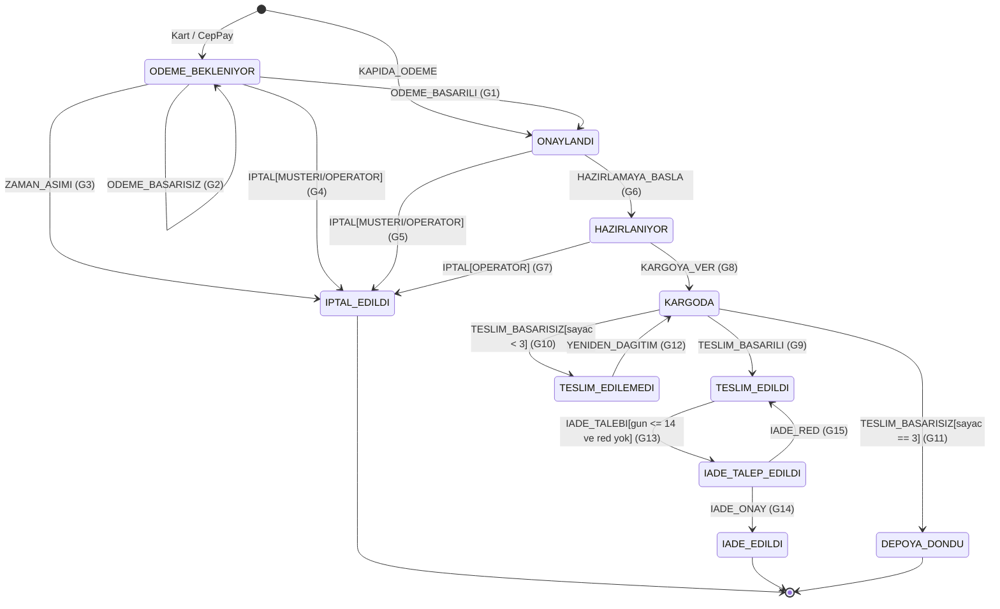

# SFM v1.4 Test Tasarım Dokümanı

**Proje:** Defne Kitap — Sipariş Fiyatlandırma Motoru (SFM) ve Sipariş Durum Yönetimi  
**Referans Spesifikasyon:** `girdiler/SFM-spesifikasyon-v1.4.md` (Doküman No: DK-SPEC-214, Onay: 22.09.2026)  
**Hazırlayan:** Kıdemli Test Analisti  
**Hedef Sürüm:** v1.4 (Geliştirme öncesi test tasarımı)

---

## 1. Yönetici Özeti ve Teslimat Envanteri

Bu çalışma, henüz kodu geliştirilmemiş SFM v1.4 spesifikasyonunun kuruş hassasiyetinde fiyatlandırma kurallarını, sipariş yaşam döngüsü durum geçişlerini ve E2E ödeme akışı konfigürasyonlarını erken aşamada (shift-left) doğrulamak için hazırlanmıştır. Test sayısını gereksiz yere şişirmeden yüksek riskli sınırları, kural etkileşimlerini ve hata öncelik sırasını kapsayacak şekilde aşağıdaki çıktılar üretilmiştir:

| Teslimat Dosyası | Kapsam | Vaka / Satır Sayısı | Uygulanan Temel Teknikler |
|---|---|---:|---|
| `cikti/test-tasarimi.md` | Test stratejisi, modeller, spesifikasyon tespitleri | — | EP, BVA, Karar Tablosu, Durum Geçiş, Pairwise, Hata Tahmini |
| `cikti/fiyat-test-verisi.csv` | `POST /api/v2/sepet/fiyatla` fiyatlandırma & hata kuralları | 85 | Denklik Sınıfları, Sınır Değer, Karar Tablosu, Öncelik Matrisi |
| `cikti/durum-gecis-testleri.csv` | Sipariş durum yaşam döngüsü (`G1`–`G15`, `10.1`–`10.6`) | 59 | Durum Geçiş Kapsamı, Negatif Matris, Koşul & Sıra Doğrulama |
| `cikti/konfigurasyon-matrisi.csv` | Manuel E2E ödeme regresyonu (`11.1`–`11.2`) | 12 | Kısıtlı Pairwise (2'li Kombinatoryal Kapsam — %100) |

**Öne Çıkan Risk ve Kritik Bulgular:**
1. Spesifikasyonun **Ek-A Örnek 4** satırı Bölüm **6.2 ve 6.5** ile çelişmektedir (`KU = 0,00` yerine `25,00 TL` olmalıdır).
2. `fiyat-test-verisi.csv` şablonunda Bölüm **9.1** çıktılarından `kupon_uygulandi` kolonu eksiktir.
3. `MAGAZA` (mağazadan teslim) teslimat tipi fiyatlandırma ve E2E'de bulunmasına rağmen Bölüm **10** durum yaşam döngüsünde modellenmemiştir.
4. `MISAFIR + CEPPAY` kombinasyonu UI kısıtı (**KS-3**) ile engellenirken SFM API katmanında (**3.3**) kabul edilmektedir.
5. E2E ödeme regresyonu için 108 olası (75 geçerli) kombinasyon yerine **12 satırla %100 2'li etkileşim kapsamı** sağlanarak manuel test süresi **18,75–27 saatten 3 saate** indirilmiştir.

---

## 2. Kullanılan Test Tasarım Teknikleri ve Gerekçeleri

1. **Denklik Sınıflarına Ayırma (Equivalence Partitioning — EP):**  
   `uyelik`, `teslimat_tipi`, `bolge`, `odeme_yontemi`, `kupon` ve olay parametrelerinin geçerli/geçersiz sınıflarını ayırarak her sınıftan en az bir temsilci seçmek ve tekrarlı test üretimini önlemek için kullanılmıştır.
2. **Sınır Değer Analizi (Boundary Value Analysis — BVA):**  
   Sayısal eşikler (`0`, `150.00`, `400.00`, `750.00`, `1500.00` tavan, `5000.00` kapıda ödeme OT limiti, `20000.00`, `gun=0/14/15`, `basarisiz_teslim=1/2/3`) ve kuruş yuvarlama sınırları (`15.004`, `15.005`, `149.994`, `149.995`, `150.005`) için ±0.01 TL ve ±1 birim hassasiyetinde kullanılmıştır.
3. **Karar Tablosu (Decision Table Testing):**  
   Kupon uygunluğu, üyelik avantajları (`ALTIN`), `NT >= 750` eşiği, uzak bölge ek ücreti, kapıda ödeme hizmet bedeli ve 7 kademeli hata öncelik sırası (`9.3`) gibi birbiriyle etkileşen kuralları eksiksiz çakıştırmak için kullanılmıştır.
4. **Durum Geçiş Testi (State Transition Testing — 0-Switch, Kısıtlı 1-Switch ve Negatif Matris):**  
   10 durum, 12 olay ve 15 geçiş (`G1`–`G15`) ile sayaç/bayrak bellekli kuralları (3 başarısız teslimat, reddedilmiş iade sonrası tekrar talebi) ve `10.5` olay işleme önceliğini doğrulamak için kullanılmıştır.
5. **Kısıtlı Çiftli Kombinatoryal Test (Constrained Pairwise / 2-Wise Testing):**  
   15 dakika/koşum maliyetli manuel E2E regresyonunda 4 faktörün tüm geçerli ikili etkileşimlerini matematiksel olarak kanıtlanabilir en az satır sayısıyla (12 satır) kapsamak için kullanılmıştır.
6. **Hata Tahmini (Error Guessing):**  
   Geçmiş sürümde yanlış beklenen değer kaynaklı yanlış alarmlar yaşandığı için geliştiricilerin sık yaptığı hatalar hedeflenmiştir: banker yuvarlama (`ROUND_HALF_EVEN`) vs yarım yukarı (`ROUND_HALF_UP`), tavan kontrolünün yuvarlama öncesinde yapılması, sepet/kapıda ödeme limitinin `NT` veya `AT` yerine `OT` üzerinden kontrol edilmemesi, `ALTIN` puanında `floor(NT / 10 * 1.5)` ile erken çarpma hatası, `MAGAZA` seçiliyken `bolge` enum doğrulamasının kapatılmaması ve hatalı durum geçişinin sayaçları bozması.

---

## 3. SFM Fiyatlandırma Motoru: Denklik Sınıfları ve Sınır Değerleri

### 3.1 Girdi Alanları Denklik Sınıfları (Bölüm 3)

| Alan | Geçerli Denklik Sınıfları | Geçersiz Denklik Sınıfları | Kapsayan Test ID'ler |
|---|---|---|---|
| `uyelik` | `MISAFIR`, `KLASIK`, `ALTIN` | Tanımsız kod (`PLATIN`), küçük harf (`klasik`), boş | `FT-01`..`FT-03`, `FT-19`..`FT-21` |
| `ara_toplam` | `(0, 150.00)` (min altı), `[150.00, 20000.00]` (geçerli aralık), `(20000.00, ∞)` (max üstü); en fazla 2 ondalık (`500.5` dahil) | `<= 0` (`0.00`, `-10.00`), >2 ondalık (`250.005`), virgül ondalık (`250,00`), binlik ayraç (`1,499.90`), boş, sayısal olmayan (`abc`) | `FT-04`..`FT-10`, `FT-17`..`FT-24`, `FT-58` |
| `kupon` | Boş (kupon yok), `DEFNE10` (baş/son boşluk kırpılır), `KITAP50` (koşul sağlayan / sağlamayan) | Tanımsız (`YILBASI20`), küçük harf (`defne10`) | `FT-25`..`FT-38` |
| `teslimat_tipi` | `STANDART`, `HIZLI`, `MAGAZA` | Tanımsız (`AYNI_GUN`), boş | `FT-11`..`FT-12`, `FT-39`..`FT-60` |
| `bolge` | `STANDART`/`HIZLI`: `NORMAL`, `UZAK`; `MAGAZA`: herhangi değer veya boş (doğrulanmaz) | `STANDART`/`HIZLI` iken boş veya tanımsız (`MERKEZ`) | `FT-13`..`FT-14`, `FT-58`..`FT-60` |
| `odeme_yontemi` | `KREDI_KARTI`, `BANKA_KARTI`, `CEPPAY` (fiyatlamada eşdeğer), `KAPIDA_ODEME` | Tanımsız (`HAVALE`), boş | `FT-15`..`FT-16`, `FT-34`, `FT-56`, `FT-61`..`FT-73` |

### 3.2 Sınır Değer Analizi (BVA)

| Kural / Eşik | Sınır Noktaları | Beklenen Davranış | Test ID'ler |
|---|---|---|---|
| `ara_toplam > 0` vs `AT < 150` | `0.00`, `0.01`, `149.99`, `150.00` | `0.00` → `ERR_GECERSIZ_GIRDI`; `0.01` & `149.99` → `ERR_MIN_SEPET`; `150.00` → `KABUL` | `FT-04`, `FT-17`..`FT-19` |
| Sepet limiti `AT` üzerinden (`4.3`) | `AT=150.00 + DEFNE10` (`NT=135.00`); `AT=20000.00`; `AT=20000.01` (+`DEFNE10`) | `150.00` (`NT=135.00`) → `KABUL`; `20000.00` → `KABUL`; `20000.01` (`NT=19850.01`) → `ERR_MAX_SEPET` | `FT-20`, `FT-22`..`FT-24` |
| `DEFNE10` yarı-yukarı yuvarlama (`2.2`) | `150.04` (`15.004`), `150.05` (`15.005`), `150.25` (`15.025`) | `15.00`, `15.01` (`half-even` `15.00` verirdi), `15.03` | `FT-28`..`FT-30` |
| `DEFNE10` 150 TL tavanı (`2.2`, `5.3`) | `1499.94` (`149.994`), `1499.95` (`149.995`), `1500.05` (`150.005`) | `149.99`, `150.00` (yuvarlanarak tavana ulaşır), `150.00` (`150.01` tavana kırpılır) | `FT-31`..`FT-33` |
| `KITAP50` alt sınırı (`5.4`, `5.5`) | `AT = 399.99`, `400.00` (`KLASIK` ve `ALTIN`) | `399.99` → hata yok, `KI=0.00`; `400.00` → `KI=50.00` | `FT-35`..`FT-37` |
| Ücretsiz kargo / `HIZLI` indirimi (`NT` eşiği `6.2`, `6.4.b`) | `NT = 749.99` vs `750.00` (kuponsuz; `KITAP50` ile `799.99/800.00`; `DEFNE10` ile `833.32/833.33`) | `749.99` → `STANDART` `39.90` / `64.90`, `HIZLI` `79.90`; `750.00` → `STANDART` `0.00` / `25.00`, `HIZLI` `40.00` | `FT-39`..`FT-49`, `FT-53`..`FT-56` |
| Kapıda ödeme `OT <= 5000.00` (`7.3`) | `NORMAL`: `4987.10` (`OT=5000.00`) vs `4987.11` (`5000.01`); `4990.00` (`NT<=5000`, `OT=5002.90`); `UZAK KLASIK`: `4962.10` vs `4962.11`; `UZAK ALTIN`: `4987.10`; `KITAP50`: `5037.10` vs `5037.11` | `OT <= 5000.00` → `KABUL`; `OT >= 5000.01` → `ERR_KAPIDA_LIMIT` | `FT-66`..`FT-73` |
| `ALTIN` puan aşağı yuvarlama (`2.3`, `8.3`) | `NT = 159.99` (`taban=15`) vs `160.00` (`taban=16`) | `159.99` → `floor(15*1.5)=22` (`floor(15.999*1.5)=23` değil); `160.00` → `24` | `FT-74`, `FT-75` |

---

## 4. Karar Tabloları

### 4.1 Kupon Karar Tablosu (Bölüm 5)

| Kural | `kupon` (kırpılmış) | Geçerli Kod? | `uyelik` | `AT` Koşulu | Beklenen Durum | `KI` | `kupon_uygulandi` | Örnek Testler |
|---|---|---|---|---|---|---|---|---|
| K1 | `""` (boş) | — | Herhangi | Geçerli | `KABUL` | `0.00` | Belirsiz (`T-02`) | `FT-19`, `FT-39` |
| K2 | Tanımsız / `defne10` | Hayır | Herhangi | Herhangi | `ERR_KUPON_GECERSIZ` | — | — | `FT-25`, `FT-26` |
| K3 | `DEFNE10` | Evet | Herhangi | `AT < 1500.00` (yuvarlama öncesi) | `KABUL` | `min(round_half_up(AT*0.10), 150.00)` | `true` | `FT-27`..`FT-32` |
| K4 | `DEFNE10` | Evet | Herhangi | `round_half_up(AT*0.10) >= 150.00` | `KABUL` | `150.00` | `true` | `FT-32`..`FT-34` |
| K5 | `KITAP50` | Evet | `KLASIK` / `ALTIN` | `AT >= 400.00` | `KABUL` | `50.00` | `true` | `FT-36`, `FT-37` |
| K6 | `KITAP50` | Evet | `KLASIK` / `ALTIN` | `AT < 400.00` | `KABUL` | `0.00` | `false` | `FT-35` |
| K7 | `KITAP50` | Evet | `MISAFIR` | Herhangi | `KABUL` | `0.00` | `false` | `FT-38` |

### 4.2 Kargo ve Kapıda Ödeme Karar Tablosu (Bölüm 6 ve 7)

*(Ön koşul: girdi, kupon kodu ve sepet limit kontrollerinden geçmiştir.)*

| `teslimat_tipi` | `bolge` | `odeme_yontemi` | `uyelik` | `NT` | Sonuç / Hata | `KU` | `HB` | Test ID |
|---|---|---|---|---|---|---|---|---|
| `HIZLI` | `UZAK` | Herhangi | Herhangi | Herhangi | `ERR_TESLIMAT_BOLGE` | — | — | `FT-57` |
| `HIZLI` / `MAGAZA` | `NORMAL` / herhangi | `KAPIDA_ODEME` | Herhangi | Herhangi | `ERR_KAPIDA_UYGUNLUK` | — | — | `FT-61`, `FT-62` |
| `MAGAZA` | Herhangi / boş | Kart / `CEPPAY` | Herhangi | Herhangi | `KABUL` | `0.00` | `0.00` | `FT-58`..`FT-60` |
| `HIZLI` | `NORMAL` | Kart / `CEPPAY` | Herhangi | `< 750.00` | `KABUL` | `79.90` | `0.00` | `FT-52`, `FT-53`, `FT-55` |
| `HIZLI` | `NORMAL` | Kart / `CEPPAY` | Herhangi | `>= 750.00` | `KABUL` | `40.00` | `0.00` | `FT-34`, `FT-54`, `FT-56` |
| `STANDART` | `NORMAL` | Kart / `CEPPAY` | `ALTIN` | Herhangi | `KABUL` | `0.00` | `0.00` | `FT-21`, `FT-37` |
| `STANDART` | `UZAK` | Kart / `CEPPAY` | `ALTIN` | Herhangi | `KABUL` | `0.00` | `0.00` | `FT-50`, `FT-51` |
| `STANDART` | `NORMAL` | Kart / `CEPPAY` | `MISAFIR`/`KLASIK` | `< 750.00` | `KABUL` | `39.90` | `0.00` | `FT-39`, `FT-41`, `FT-43` |
| `STANDART` | `NORMAL` | Kart / `CEPPAY` | `MISAFIR`/`KLASIK` | `>= 750.00` | `KABUL` | `0.00` | `0.00` | `FT-40`, `FT-42`, `FT-44` |
| `STANDART` | `UZAK` | Kart / `CEPPAY` | `MISAFIR`/`KLASIK` | `< 750.00` | `KABUL` | `64.90` | `0.00` | `FT-45`, `FT-48` |
| `STANDART` | `UZAK` | Kart / `CEPPAY` | `MISAFIR`/`KLASIK` | `>= 750.00` | `KABUL` | `25.00` | `0.00` | `FT-46`, `FT-47`, `FT-49` |
| `STANDART` | `NORMAL`/`UZAK` | `KAPIDA_ODEME` | Herhangi | Yukarıdaki `KU` + `HB=12.90`, `OT <= 5000.00` | `KABUL` | `KU` | `12.90` | `FT-63`..`FT-66`, `FT-69`, `FT-71`, `FT-72` |
| `STANDART` | `NORMAL`/`UZAK` | `KAPIDA_ODEME` | Herhangi | `OT > 5000.00` | `ERR_KAPIDA_LIMIT` | — | — | `FT-67`, `FT-68`, `FT-70`, `FT-73` |

### 4.3 Hata Öncelik Sırası Doğrulama Matrisi (Bölüm 9.3)

| Öncelik | Kazanan Hata | Bastırılan Alt Öncelikli Hatalar | Doğrulayan Test ID |
|---:|---|---|---|
| 1 | `ERR_GECERSIZ_GIRDI` | `ERR_KUPON_GECERSIZ`, `ERR_MIN_SEPET`, `ERR_TESLIMAT_BOLGE`, `ERR_KAPIDA_UYGUNLUK` | `FT-77` |
| 2 | `ERR_KUPON_GECERSIZ` | `ERR_MIN_SEPET`, `ERR_MAX_SEPET`, `ERR_TESLIMAT_BOLGE`, `ERR_KAPIDA_UYGUNLUK`, `ERR_KAPIDA_LIMIT` | `FT-78`, `FT-79` |
| 3 | `ERR_MIN_SEPET` | `ERR_TESLIMAT_BOLGE`, `ERR_KAPIDA_UYGUNLUK` | `FT-80` |
| 4 | `ERR_MAX_SEPET` | `ERR_TESLIMAT_BOLGE`, `ERR_KAPIDA_UYGUNLUK`, `ERR_KAPIDA_LIMIT` | `FT-81`, `FT-82` |
| 5 | `ERR_TESLIMAT_BOLGE` | `ERR_KAPIDA_UYGUNLUK`, `ERR_KAPIDA_LIMIT` | `FT-83` |
| 6 | `ERR_KAPIDA_UYGUNLUK` | `ERR_KAPIDA_LIMIT` (`HIZLI` ve `MAGAZA` için ayrı ayrı) | `FT-84`, `FT-85` |
| 7 | `ERR_KAPIDA_LIMIT` | *(Tek başına oluştuğunda)* | `FT-67`, `FT-70` |

---

## 5. Sipariş Durum Geçiş Modeli (Bölüm 10)

### 5.1 Durum Geçiş Diyagramı

### 5.2 Geçerli ve Geçersiz Geçişler Matrisi

- **Tüm geçerli geçişler (`G1`–`G15`) ve başlangıç durumları (`10.2`):** `DG-01`..`DG-26` ile %100 kapsanmıştır (`G4` ve `G5` için her iki aktör, `G10`/`G11` için 1., 2. ve 3. teslim denemeleri, 2 başarısızlık sonrası 3. denemede teslim `DG-21`, `IADE_TALEBI` için `gun=0` ve `gun=14`).
- **Koşul ihlalleri (`G7`, `G13`):**
  - `HAZIRLANIYOR` + `IPTAL(aktor=MUSTERI)` → `ERR_GECERSIZ_GECIS` (`DG-27`)
  - `TESLIM_EDILDI` + `IADE_TALEBI(gun=15)` → `ERR_IADE_SURESI` (`DG-28`)
  - `IADE_RED` sonrası `IADE_TALEBI(gun=6)` → `ERR_IADE_TEKRAR` (`DG-29`)
  - `IADE_RED` sonrası `IADE_TALEBI(gun=15)` → `ERR_IADE_SURESI` (`10.5.4`: süre tekrar kontrolünden önce gelir, `DG-30`)
- **Geçersiz geçişler (`10.5.2`, `10.6` ve son durumlar):**
  - Ara durumlardan geçersiz olay atlamaları, `KAPIDA_ODEME` başlangıcında `ODEME_BASARILI` reddi (`DG-33`), `KARGODA` durumunda hem `MUSTERI` hem `OPERATOR` iptalinin yasaklanması (`DG-37`, `DG-38`), `TESLIM_EDILEMEDI` iken `YENIDEN_DAGITIM` olmadan teslim edilememesi (`DG-40`), `IADE_TALEP_EDILDI` iken ikinci iade talebi ve iptalin yasaklanması (`DG-44`, `DG-45`).
  - Son durumlar (`IPTAL_EDILDI`, `IADE_EDILDI`, `DEPOYA_DONDU`): geçerli bir olay geldiğinde `ERR_GECERSIZ_GECIS` döner (`DG-46`..`DG-48`).
- **Olay işleme sırası (`10.5.1` → `10.5.2` → `10.5.3` → `10.5.4`):**
  - `10.5.1 > 10.5.2`: Son durum `IPTAL_EDILDI` iken bile tanımsız olay `BILINMEYEN_OLAY` geldiğinde `ERR_GECERSIZ_GIRDI` döner (`DG-50`).
  - `10.5.2 > 10.5.3`: Olay o durumda hiç tanımlı değilse parametre geçersiz olsa bile `ERR_GECERSIZ_GECIS` döner (`DG-51`: `KARGODA` + `IPTAL(aktor=YONETICI)`, `DG-52`: `HAZIRLANIYOR` + `IADE_TALEBI(gun=-1)`).
  - `10.5.3 > 10.5.4`: Geçerli geçişte eksik/geçersiz parametreler (`IPTAL`, `aktor=SISTEM`, `aktor=musteri`, `IADE_TALEBI`, `gun=-1`, `gun=1.5`, `gun=abc`) `ERR_GECERSIZ_GIRDI` döner (`DG-53`..`DG-59`).

### 5.3 Kural 10.5.5 (Hata Sonrası Durum ve Sayaç Değişmezliği) — Çok Adımlı Ek Senaryolar

CSV şablon kuralı gereği `olay_dizisi` içindeki son olay hariç tüm ön olayların geçerli (`KABUL`) olması gerektiğinden, hata aldıktan **sonra** akışa devam edilmesini sınayan şu 3 senaryo entegrasyon/API otomasyonunda ayrı test olarak koşulmalıdır:
1. **İade süre hatasının tekrar sayacını bozmaması:** `TESLIM_EDILDI` → `IADE_TALEBI(gun=15)` (`ERR_IADE_SURESI`) → ardından `IADE_TALEBI(gun=10)` (`KABUL` → `IADE_TALEP_EDILDI` olmalı; başarısız istek "reddedilmiş iade" olarak işaretlenmemelidir).
2. **Geçersiz olayın teslimat deneme sayacını bozmaması:** `KARGODA` → `IPTAL(aktor=OPERATOR)` (`ERR_GECERSIZ_GECIS`) → ardından `TESLIM_BASARISIZ` (`TESLIM_EDILEMEDI`, sayaç=1 olmalı).
3. **`HAZIRLANIYOR` müşteri iptali sonrası akışın sürmesi:** `HAZIRLANIYOR` → `IPTAL(aktor=MUSTERI)` (`ERR_GECERSIZ_GECIS`) → ardından `KARGOYA_VER` (`KABUL` → `KARGODA`).

---

## 6. E2E Konfigürasyon Matrisi Yaklaşımı (Bölüm 11)

- **Tam Kombinasyon Uzayı:** `3 (platform) × 4 (odeme_yontemi) × 3 (teslimat_tipi) × 3 (uyelik) = 108` kombinasyon (manuel ~27 saat).
- **Kısıtlar Sonrası Geçerli Uzay (`KS-1`, `KS-2`, `KS-3`):**  
  - `KS-1`: `KAPIDA_ODEME` → yalnızca `STANDART` (18 kombinasyon elenir)
  - `KS-2`: `CEPPAY` → `WEB` yasak (9 kombinasyon elenir)
  - `KS-3`: `CEPPAY` → `MISAFIR` yasak (6 ek kombinasyon elenir)
  - Kalan geçerli kombinasyon sayısı: **75** (manuel ~18,75 saat).
- **Pairwise (2'li Kapsama) Çözümü ve Alt Sınır İspatı:**  
  Geçerli 75 kombinasyon içindeki tüm geçerli 2'li faktör çiftlerinin sayısı **59**'dur. Seçilen `konfigurasyon-matrisi.csv` (**12 satır**):
  1. `WEB` kullanıcıları `CEPPAY` kullanamadığından `WEB` × `{KREDI_KARTI, BANKA_KARTI, KAPIDA_ODEME}` için **en az 3 satır**,
  2. `IOS` × `{KREDI_KARTI, BANKA_KARTI, KAPIDA_ODEME}` için **en az 3 satır**,
  3. `ANDROID` × `{KREDI_KARTI, BANKA_KARTI, KAPIDA_ODEME}` için **en az 3 satır**,
  4. `CEPPAY` × `{STANDART, HIZLI, MAGAZA}` için **en az 3 satır** gereklidir.  
  Bu 4 küme ayrık olduğundan **12 satır matematiksel olarak mümkün olan en küçük (minimum) matristir**.
- **Elde Edilen Kapsam ve Süre Kazancı:**
  - **2'li (Pairwise) Kapsama:** **59 / 59 (%100)**
  - **3'lü Kapsama (ek kazanım):** **47 / 112 (%42,0)**
  - **Faktör Dengesi:** Her ödeme yöntemi tam 3 kez; platformlar (`ANDROID`: 5, `IOS`: 4, `WEB`: 3), teslimatlar (`STANDART`: 6, `HIZLI`: 3, `MAGAZA`: 3), üyelikler (`KLASIK`: 5, `ALTIN`: 4, `MISAFIR`: 3).
  - **Manuel Süre:** `12 × 15 dk = 180 dk (3 saat)` — tam uzaya göre **%88,9**, geçerli uzaya göre **%84,0** süre tasarrufu.
- **UI Negatif Kısıt Doğrulaması (Matris Dışı Hızlı Kontrol):** `KS-1` (`KAPIDA_ODEME` + `HIZLI`/`MAGAZA`), `KS-2` (`WEB` + `CEPPAY`) ve `KS-3` (`MISAFIR` + `CEPPAY`) seçeneklerinin ödeme ekranında gizlendiği/devre dışı bırakıldığı 3 kısa UI kontrolüyle ayrıca doğrulanmalıdır.

---

## 7. Spesifikasyonla İlgili Tespitler, Tutarsızlıklar ve Sorular

| ID | Önem | Bölüm | Tespit / Tutarsızlık | Ekibe Sorular ve Öneri |
|---|---|---|---|---|
| **T-01** | **Kritik** | Ek-A Örnek 4 vs 6.2 & 6.5 | **Doğrudan çelişki:** Ek-A Örnek 4 (`KLASIK`, `AT=900,00`, `STANDART`, `UZAK`) satırında `KU = 0,00` ve `OT = 900,00` yazılmıştır. Oysa 6.5 gereği 6.2 ücretsiz standart kargo yalnızca taban ücreti (`39,90`) kapsar, `25,00 TL` uzak bölge ek ücretini kapsamaz (bunu yalnızca 6.3 `ALTIN` kapsar). Doğru değer `KU = 25,00` ve `OT = 925,00` olmalıdır (`FT-46`). | Ek-A Örnek 4 güncellenmeli; geliştirici/otomasyon ekiplerinin Ek-A'dan kopyalama yapmaması sağlanmalıdır. |
| **T-02** | **Yüksek** | 5.5 & 9.1 vs CSV Şablonu | 9.1'de başarılı yanıtta `kupon_uygulandi` alanı tanımlanmıştır, ancak `fiyat-test-verisi.csv` şablonunda `beklenen_kupon_uygulandi` kolonu yoktur. Ayrıca `kupon` boş gönderildiğinde bu alan `false` mı yoksa `null`/yok mu dönecektir? | Otomasyon şablonuna kolon eklenip eklenmeyeceği ve kuponsuz isteklerde `kupon_uygulandi` değeri netleştirilmelidir. |
| **T-03** | **Yüksek** | 3, 6.6, 11.1 vs 10.4 | **`MAGAZA` yaşam döngüsü eksikliği:** Mağazadan teslim (`MAGAZA`) desteklenmesine rağmen Bölüm 10 yalnızca kargo süreçlerini (`KARGOYA_VER`, `KARGODA`, `TESLIM_BASARISIZ`, `DEPOYA_DONDU`) tanımlamaktadır. | `MAGAZA` siparişleri için ayrı durum/olay var mı, yoksa geçici olarak kargo akışı mı kullanılacak? |
| **T-04** | **Yüksek** | 3.3 vs 11.2 (KS-3) | **API katmanı yetki boşluğu:** SFM `MISAFIR + CEPPAY` isteğini `KABUL` etmektedir (`FT-58`). UI KS-3'ü kapatsa da doğrudan API çağrısında sipariş oluşturma servisinin KS-3'ü engelleyip engellemeyeceği Bölüm 10'da belirtilmemiştir. | Sipariş oluşturma (`POST /orders` vb.) adımında `MISAFIR + CEPPAY` sunucu tarafında reddedilecek mi? |
| **T-05** | **Orta** | 5.2 | **Yalnızca boşluk içeren kupon (`"   "`):** Baş/son boşluklar kırpıldığında boş string elde edilir. Bu girdi "kupon yok" (`KABUL`) mu yoksa `ERR_KUPON_GECERSIZ` mi olmalıdır? | Geliştirme öncesi karar verilmelidir (belirsizlik nedeniyle `fiyat-test-verisi.csv`'ye kesin iddia olarak konmamıştır). |
| **T-06** | **Orta** | 3 & 3.1 | **JSON tip/biçim ve `MAGAZA` + `bolge` deserialization riski:** `ara_toplam` JSON `number` ise `1499.90` vs `1499.9` veya `1,499.90` doğrulaması katmanına göre değişir. Ayrıca `MAGAZA` iken `bolge` alanının "doğrulanmaması" (`FT-60`) enum deserialization katmanında 400 hatasıyla çakışabilir. | `ara_toplam` JSON tipi (`number`/`string`) ve `MAGAZA` durumunda `bolge` validasyonunun API şema katmanında devre dışı bırakılması netleştirilmelidir. |
| **T-07** | **Orta** | 10.3–10.5 | **Durum makinesi uç detayları:** (a) `ZAMAN_ASIMI` tam 30:00 sınırında nasıl tetiklenir, `ODEME_BASARISIZ` süreyi sıfırlar mı veya deneme limiti var mı? (b) `ODEME_BASARILI` ile `ZAMAN_ASIMI` yarış durumunda atomiklik? (c) Parametresiz olaylara fazladan parametre verilmesi (`ODEME_BASARILI(aktor=MUSTERI)`) `ERR_GECERSIZ_GIRDI` mi döner? (d) `KAPIDA_ODEME` siparişinde iade (`IADE_EDILDI`) gerçekleşirse `HB=12,90` iade edilir mi? (e) `gun` takvim günü hesabında saat dilimi nedir? | Ürün sahibi ve teknik ekiple netleştirilmesi önerilir. |
| **T-08** | **Düşük** | 11.1 | E2E matrisinde `bolge` ve `kupon` faktörleri yer almamaktadır. | E2E testlerinde bu iki alanın temsili varsayılanlarla (ve API testleriyle kapsanarak) koşulacağı teyit edilmelidir. |

---

## 8. Varsayımlar ve Kapsam Dışı Bırakılanlar

### 8.1 Varsayımlar
- Ek-A'daki not gereği Ek-A Örnek 4 ile Bölüm 6.2/6.5 çelişkisinin çözümünde **Bölüm 4–8 kuralları** esas alınmıştır (`FT-46`: `KU = 25.00`, `OT = 925.00`).
- `ara_toplam` için "en fazla 2 ondalık basamaklı" tanımı gereği 0 ve 1 ondalıklı geçerli sayıların (`500.5` — `FT-58`) kabul edildiği, ancak çıktı kolonlarının her zaman 2 ondalık basamaklı (`2.1`) üretildiği varsayılmıştır.
- Otomasyon CSV okuyucusunun hücre içi baş/son boşlukları otomatik kırpmadığı (`FT-27`: ` DEFNE10 `) varsayılmıştır.
- `10.5.3` kapsamında parametresiz olaylara beklenmeyen parametre gönderiminin `ERR_GECERSIZ_GIRDI` üreteceği öngörülmüştür; ancak belirsizlik olarak `T-07`'de ayrıca raporlanmıştır.
- Tüm test verileri tamamen sentetiktir.

### 8.2 Kapsam Dışı Bırakılanlar
- **Spesifikasyon Bölüm 1 gereği kapsam dışı:** Stok kontrolü, ürün bazlı kampanyalar, fatura oluşturma, puanların hesaba geçmesi ve harcanması, kargo firması entegrasyonu.
- **Teknik / Fonksiyonel Olmayan Alanlar:** Yük ve performans testleri, kimlik doğrulama / yetkilendirme / API rate-limit güvenlik testleri, eşzamanlı istek (concurrency / race condition) testleri, tarayıcı ve mobil OS sürüm uyumluluk matrisi (E2E matrisi yalnızca spesifikasyondaki `WEB`, `IOS`, `ANDROID` platform düzeyindedir).
